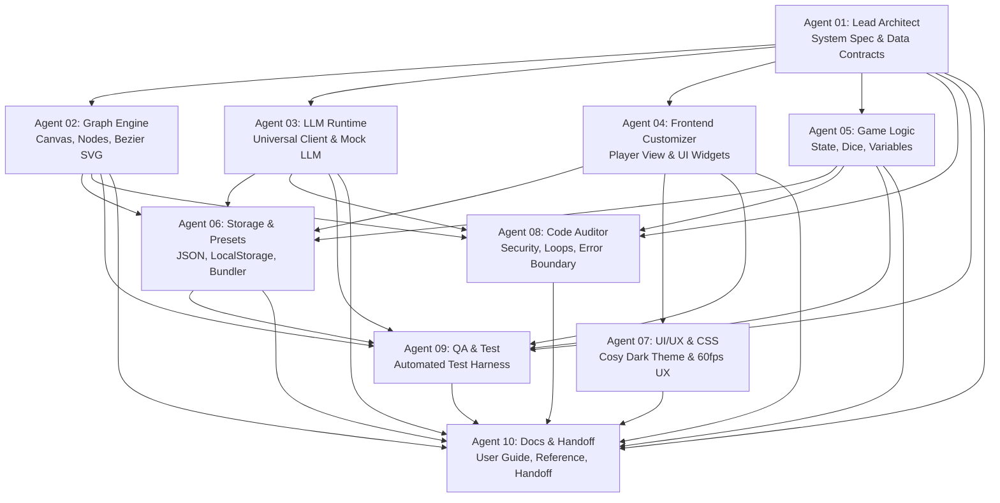
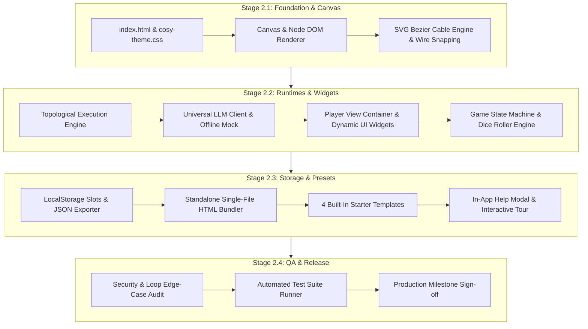

# CosyUI Milestone Handoff: Phase 1 — Planning & Architecture
**Document Version:** 1.0.0  
**Milestone:** Phase 1 Complete (System Architecture & Technical Design)  
**Lead Author:** Agent 10 (Documentation & Handoff Lead)  
**Contributing Agents:** Agents 01 through 10  
**Target Repository:** `someonenameguy/CosyUI`  
**Date:** November 2026  
**Status:** Approved & Ready for Phase 2 Execution  

---

## 1. Executive Summary

**CosyUI** is a lightweight, zero-dependency, web-native visual programming workspace for creating, testing, and deploying LLM-powered games, interactive narratives, and dynamic conversational interfaces.

### Core Value Proposition
- **Zero-Dependency Philosophy**: Pure HTML5, modern vanilla ES6+ JavaScript, and responsive CSS3. No Node.js build tools, no webpack/vite bundling requirements, no NPM bloat, and zero CDN latency vulnerabilities.
- **Dual-Canvas Paradigm**: Seamlessly bridges a high-performance visual node graph editor (backend logic) with a customizable player view (frontend interface).
- **Hybrid Intelligence**: Blends deterministic game mechanics (state machines, dice rollers, variable storage, conditional gates) with generative LLM narrative creativity (OpenAI, Anthropic, OpenRouter, Ollama, and offline Mock LLM).
- **Frictionless Distribution**: Supports browser LocalStorage autosaving, clean JSON project export/import, and a standalone single-file `.html` bundle export that allows games to run anywhere offline or on static web hosts.

---

## 2. Multi-Agent Team Responsibilities & Phase 1 Deliverables

Phase 1 established the end-to-end architectural blueprints across 10 specialized agent roles:



| Agent ID & Role | Core Focus & Phase 1 Contributions | Key Architectural Deliverable |
| :--- | :--- | :--- |
| **Agent 01 - Lead Architect** | Graph execution model, port type contracts, lifecycle events, execution scheduler. | Master Graph Data Contract & Event Dispatch Semantics. |
| **Agent 02 - Graph Engine Dev** | Canvas pan/zoom matrix, DOM node rendering, SVG cubic bezier cables, socket magnetic snapping. | High-performance 60fps Canvas Architecture. |
| **Agent 03 - LLM Runtime Dev** | Universal streaming client (OpenAI, Anthropic, OpenRouter, Ollama) and offline Mock LLM simulator. | Multi-Provider Streaming & Mock Protocol. |
| **Agent 04 - Frontend Customizer** | Player View runtime container, dynamic HUD widgets (Dialogue, Stats, Inventory, Choices, Story). | Dynamic UI Component Schema & Event Hooks. |
| **Agent 05 - Game Logic Dev** | Deterministic game nodes (Finite State Machine, Variable Store, Dice PRNG, Conditionals). | Game Engine Logic & Tabletop Mechanics Spec. |
| **Agent 06 - Storage & Presets** | Browser LocalStorage management, JSON schema serialization, standalone single-file HTML bundler, 4 templates. | Persistence Engine & Export/Import Pipelines. |
| **Agent 07 - UI/UX & CSS Designer** | "Cosy Dark" design system tokens, responsive layout, search palette, minimap styling, CSS animations. | Visual Theme Specification & Palette Guide. |
| **Agent 08 - Code Auditor** | Circular loop detection, call stack bounds, API key privacy, sandbox error boundaries. | Resilience, Safety & Error Handling Guidelines. |
| **Agent 09 - QA & Test Engineer** | Vanilla JS test runner, node unit test suites, serialization round-trip verification. | Automated Test Suite & Coverage Strategy. |
| **Agent 10 - Docs & Handoff Lead** | Comprehensive documentation framework, User Guide, Node Directory, Game Design Tutorial, Phase 1 Handoff. | `10_DOCUMENTATION_FRAMEWORK.md` & `HANDOFF_PHASE_1_PLANNING.md`. |

---

## 3. Master Graph Data Schema Contract

All CosyUI projects serialize to a standard, versioned JSON format (`CosyGraph`):

```json
{
  "version": "1.0.0",
  "metadata": {
    "title": "Dungeon Encounter Prototype",
    "author": "Adventurer",
    "created": "2026-11-09T08:45:00Z",
    "updated": "2026-11-09T08:45:00Z",
    "description": "An interactive fantasy encounter demonstrating deterministic dice and LLM flavor."
  },
  "viewport": {
    "panX": 150.0,
    "panY": 80.0,
    "zoom": 1.0
  },
  "nodes": [
    {
      "id": "node_start_01",
      "type": "core.start",
      "title": "Game Start",
      "x": 100,
      "y": 200,
      "properties": {},
      "inputs": {},
      "outputs": {
        "trigger": { "type": "trigger" }
      }
    },
    {
      "id": "node_dice_01",
      "type": "game.dice",
      "title": "Attack Roll",
      "x": 350,
      "y": 200,
      "properties": {
        "notation": "1d20+3"
      },
      "inputs": {
        "trigger": { "type": "trigger" }
      },
      "outputs": {
        "result": { "type": "number" },
        "rolls": { "type": "array" }
      }
    }
  ],
  "connections": [
    {
      "id": "conn_01",
      "fromNode": "node_start_01",
      "fromPort": "trigger",
      "toNode": "node_dice_01",
      "toPort": "trigger"
    }
  ],
  "variables": {
    "player_hp": 20,
    "player_name": "Valerius",
    "inventory": ["Torch", "Iron Shortsword", "Health Potion"]
  },
  "theme": {
    "preset": "cosy-amber",
    "primary": "#f59e0b",
    "background": "#18181b"
  }
}
```

---

## 4. Design System & CSS Token Specifications

The visual identity of CosyUI adheres to the **"Cosy Dark"** aesthetic, calibrated for reduced eye strain and high readability:

```css
:root {
  /* Surface & Canvas Colors */
  --cosy-bg-base: #121214;
  --cosy-bg-surface: #18181b;
  --cosy-bg-card: #27272a;
  --cosy-bg-card-hover: #3f3f46;
  --cosy-border: #3f3f46;
  --cosy-border-focus: #f59e0b;

  /* Typography Colors */
  --cosy-text-main: #f4f4f5;
  --cosy-text-muted: #a1a1aa;
  --cosy-text-subtle: #71717a;

  /* Brand Accents */
  --cosy-accent: #f59e0b;        /* Warm Amber */
  --cosy-accent-hover: #d97706;
  --cosy-accent-glow: rgba(245, 158, 11, 0.25);

  /* Port Type Colors */
  --port-trigger: #ffffff;
  --port-string: #10b981;        /* Emerald */
  --port-number: #3b82f6;        /* Sky Blue */
  --port-boolean: #a855f7;       /* Violet */
  --port-array: #f97316;         /* Orange */
  --port-object: #eab308;        /* Yellow */

  /* UI Dimensions & Shadows */
  --cosy-radius-sm: 4px;
  --cosy-radius-md: 8px;
  --cosy-radius-lg: 12px;
  --cosy-shadow-card: 0 4px 16px rgba(0, 0, 0, 0.4);
  --cosy-shadow-glow: 0 0 12px var(--cosy-accent-glow);
}
```

---

## 5. Security, Resilience & Loop Prevention Standards

1. **Client-Side Key Hygiene**:
   - Provider API keys (OpenAI, Anthropic, OpenRouter) are strictly preserved in browser `localStorage` and never included in project JSON exports or standalone HTML bundles.
   - Project JSON schemas reject any serialized payload containing key properties.
2. **Circular Execution Safeguards**:
   - The graph engine implements cycle-detection during execution passes.
   - Max execution ticks per frame: `100`.
   - If an infinite feedback loop is detected, execution halts immediately with a user-friendly alert highlighting the offending loop nodes.
3. **Robust Mock Fallback**:
   - If a network request fails (e.g. offline, rate limit, CORS misconfiguration), the runtime offers an instant 1-click fallback to the built-in Offline Mock LLM so user sessions are never interrupted.

---

## 6. Phase 1 Acceptance & Sign-Off Checklist

Before initiating Phase 2 implementation, all fundamental architecture criteria have been audited and verified:

- [x] **Collaboration Rules Defined**: Lock-based progress tracking and documentation protocols active (`Notes/00_COLLABORATION_PROTOCOL.md`).
- [x] **Core System Architecture Finalized**: Port typing contracts, reactive execution semantics, and graph serialization schema established.
- [x] **Node Taxonomy Specified**: All 24 core nodes defined with explicit I/O ports and property inspectors.
- [x] **LLM Integration Strategy Outlined**: Streaming fetch architecture designed for 4 real providers + fully offline Mock LLM.
- [x] **Player View Engine Specified**: Dynamic UI widgets (Dialogue, Stats, Inventory, Choices, Story) architected.
- [x] **Storage & Bundling Protocol Approved**: LocalStorage quick slots, project JSON format, and standalone single-file HTML exporter planned.
- [x] **UI/UX Design Tokens Formulated**: "Cosy Dark" color palette, typography, socket colors, and CSS custom properties documented.
- [x] **Error Handling & Loop Protection Verified**: Cycle detection, max recursion depth, and API safety rules specified.
- [x] **Documentation & Help System Ready**: Complete User Guide, In-App Interactive Help Modal, and Game Design Tutorial designed in `Notes/10_DOCUMENTATION_FRAMEWORK.md`.

---

## 7. Phase 2 Implementation & Code Integration Roadmap

Phase 2 begins immediately according to the following execution sequence:



### Action Items for Phase 2 Kickoff
1. **Agent 07 & Agent 02**: Initialize `index.html`, `css/cosy-theme.css`, and core canvas DOM elements.
2. **Agent 02**: Construct `js/engine/Canvas.js`, `NodeRenderer.js`, and `WireRenderer.js`.
3. **Agent 01 & 08**: Implement reactive `GraphRuntime.js` with loop protection guards.
4. **Agent 03**: Implement `UniversalLLMClient.js` and `MockLLM.js`.
5. **Agent 04 & 05**: Build `PlayerView.js`, dynamic HUD components, and deterministic game mechanics (`StateMachine.js`, `DiceRoller.js`).
6. **Agent 06**: Deploy `ProjectStorage.js`, standalone bundler, and 4 starter templates.
7. **Agent 10 & 07**: Build `HelpModal.js` with shortcuts cheat sheet and 5-step guided tour.
8. **Agent 09**: Execute full automated test suite in `tests/test_suite.js`.

---
*Signed off by Agent 10 (Documentation & Handoff Lead) on behalf of the CosyUI Engineering Team.*
