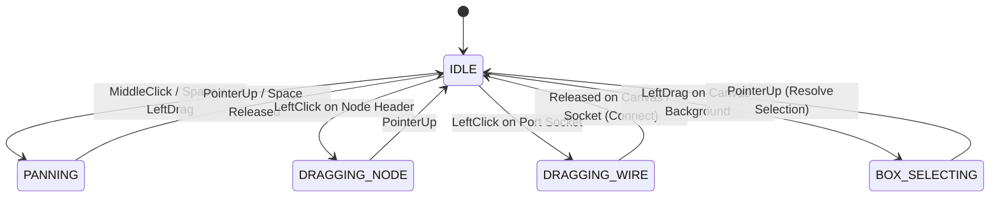

# CosyUI Graph Engine Specification (Agent 02)

**Author:** Agent 02 — Graph Engine Specialist  
**Status:** Approved Architectural Specification  
**Target:** Vanilla HTML5 / Canvas / SVG / DOM Hybrid Graph Editor  
**Dependency Level:** Zero External Dependencies (100% Vanilla ES2022 / HTML5 / CSS3)  

---

## 1. Executive Summary & Engine Goals

The **CosyUI Graph Engine** is the visual and interactive core of the CosyUI platform. It provides an ultra-responsive, buttery-smooth (60 FPS), infinite-canvas node editor capable of handling complex LLM reasoning chains, state machines, game logic, and interactive user interface workflows.

### Core Objectives:
1. **Zero External Dependencies**: Pure vanilla JavaScript (ES2022+), native Canvas 2D API, SVG path geometry, and hardware-accelerated CSS transforms. No heavy libraries (no React Flow, no LiteGraph, no D3, no PixiJS, no jQuery).
2. **60 FPS Performance Under Load**: Smooth panning, zooming, and multi-node dragging even with 100+ nodes and 200+ connecting cables.
3. **Hybrid DOM + Canvas Architecture**:
   - **DOM Layer for Nodes**: Native form controls (`<input>`, `<textarea>`, `<select>`, `<button>`), accessible text selection, smooth CSS hover transitions, and flexible auto-resizing layouts.
   - **Canvas Layer for Interconnections & Background**: High-performance batch-rendered cubic Bézier cables, glowing connection paths, animated flow pulses, and infinite viewport grids.
   - **Interaction Overlay**: Real-time interactive wire dragging and marquee box-selection with zero DOM layout thrashing.
4. **Seamless Coordinate Transformations**: Sub-pixel accurate mapping between World Space (invariant graph coordinates) and Screen Space (pointer events, CSS pixels, High-DPI / Retina displays).
5. **Rigorous Typing & Magnetic Snapping**: Intuitive port color coding, compatible socket validation, multi-fanout vs. single-input enforcement, and magnetic snap assistance.
6. **Integrated Navigation & Minimap**: Real-time viewfrustum tracking, interactive minimap panning, and automatic view-fitting bounding box calculations.

---

## 2. Zero-Dependency Hybrid Architecture (DOM + Canvas)

### 2.1 The Architectural Trade-Off Analysis
Traditional web-based node editors suffer from one of two extremes:
- **Pure Canvas / WebGL Editors**: High rendering speed for cables and simple shapes, but re-implementing text carets, multi-line wrapping, form inputs, dropdowns, and clipboard copying inside Canvas is brittle, inaccessible, and ballooning in code size.
- **Pure DOM / SVG Editors**: Easy UI styling with CSS, but hundreds of SVG `<path>` and `<g>` elements subjected to real-time drag/zoom updates cause continuous browser reflows, style recalculations, and catastrophic frame drops below 30 FPS.

**The CosyUI Hybrid Solution**:
We decouple **Visual Cabling** (Canvas 2D) from **Interactive Controls** (DOM Nodes).

```
+-------------------------------------------------------------------+
| CosyUI Viewport Container (overflow: hidden, position: relative)  |
|                                                                   |
|  [ Layer 0 ] <canvas id="graph-grid-canvas">                      |
|              Infinite dot/grid pattern transformed by pan/zoom    |
|                                                                   |
|  [ Layer 1 ] <canvas id="graph-cable-canvas">                     |
|              Batch-rendered cubic Bezier cables & flow pulses     |
|                                                                   |
|  [ Layer 2 ] <div id="graph-node-container">                      |
|              CSS transform: translate3d(tx, ty, 0) scale(s)       |
|              +-- <div class="cosy-node" style="left, top">...     |
|              +-- <div class="cosy-node" style="left, top">...     |
|                                                                   |
|  [ Layer 3 ] <canvas id="graph-interaction-overlay">              |
|              Active dragging wire, snap halo, marquee box         |
|                                                                   |
|  [ Layer 4 ] <div id="graph-hud"> (Fixed Screen Space)            |
|              Minimap canvas, Zoom controls, Quick-Search palette  |
+-------------------------------------------------------------------+
```

### 2.2 Z-Index Stacking & DOM Layout
```html
<div class="cosy-graph-viewport" id="graphViewport">
  <!-- Layer 0: Infinite Canvas Grid -->
  <canvas class="cosy-layer cosy-grid-layer" id="gridCanvas"></canvas>

  <!-- Layer 1: Static and Animated Cables -->
  <canvas class="cosy-layer cosy-cable-layer" id="cableCanvas"></canvas>

  <!-- Layer 2: Transform Plane for DOM Nodes -->
  <div class="cosy-node-stage" id="nodeStage">
    <!-- Individual nodes positioned in graph coordinates -->
  </div>

  <!-- Layer 3: Interaction Overlay (Temporary cables, Marquee box) -->
  <canvas class="cosy-layer cosy-overlay-layer" id="overlayCanvas"></canvas>

  <!-- Layer 4: Screen-space HUD & Minimap -->
  <div class="cosy-hud-overlay" id="hudOverlay">
    <div class="cosy-minimap-panel" id="minimapContainer">
      <canvas id="minimapCanvas" width="220" height="150"></canvas>
      <div id="minimapFrustum" class="cosy-minimap-frustum"></div>
    </div>
    <div class="cosy-view-controls">
      <button id="btnZoomIn" title="Zoom In">+</button>
      <button id="btnZoomOut" title="Zoom Out">−</button>
      <button id="btnZoomFit" title="Fit to View">⛶</button>
      <button id="btnZoomReset" title="Reset (100%)">1:1</button>
      <span id="zoomReadout" class="cosy-zoom-readout">100%</span>
    </div>
  </div>
</div>
```

### 2.3 CSS Hardware Acceleration Rules
To eliminate layout thrashing during pan and zoom:
1. The `#nodeStage` element uses `transform-origin: 0 0;` and GPU-accelerated 3D matrix transforms:
   ```css
   .cosy-node-stage {
     position: absolute;
     top: 0;
     left: 0;
     width: 0;
     height: 0;
     transform-origin: 0 0;
     will-change: transform;
     pointer-events: none; /* Allows canvas clicks through gaps */
   }
   .cosy-node {
     position: absolute;
     pointer-events: auto; /* Re-enable pointer events on the actual nodes */
     user-select: none;
     will-change: transform;
   }
   ```
2. Canvas layers are sized to match the container viewport in screen pixels and repositioned at `top: 0; left: 0;` with `pointer-events: none;` (the viewport container captures raw pointer events and dispatches them).

---

## 3. Coordinate Systems & Transform Mathematics

### 3.1 Spatial Reference Frames
The engine maintains two distinct coordinate systems:
1. **Screen / Client Space ($\mathbf{S}$)**:
   - Measured in CSS pixels relative to the graph viewport container's top-left corner $(0, 0)$.
   - Origin of user input: `event.clientX - containerRect.left`, `event.clientY - containerRect.top`.
2. **World / Graph Space ($\mathbf{W}$)**:
   - Invariant virtual space where nodes, sockets, and connection paths reside.
   - Node coordinates $(X_w, Y_w)$ remain unchanged regardless of camera pan or zoom.

### 3.2 Viewport Transform State
The camera transform is governed by a 2D affine transformation state vector:
$$\mathbf{T} = \begin{pmatrix} t_x \\ t_y \end{pmatrix}, \quad s \in [s_{\min}, s_{\max}]$$
- $t_x, t_y$: Viewport pan translation offsets in Screen pixels.
- $s$: Uniform scale factor (zoom level), where $s_{\min} = 0.15$ (15%), $s_{\max} = 2.50$ (250%), default $s = 1.0$.

### 3.3 Forward Transform ($\mathbf{W} \to \mathbf{S}$)
Converts a point from World space to Screen pixel space:
$$\begin{pmatrix} X_s \\ Y_s \end{pmatrix} = \begin{pmatrix} s & 0 \\ 0 & s \end{pmatrix} \begin{pmatrix} X_w \\ Y_w \end{pmatrix} + \begin{pmatrix} t_x \\ t_y \end{pmatrix}$$
$$X_s = X_w \cdot s + t_x, \quad Y_s = Y_w \cdot s + t_y$$

### 3.4 Inverse Transform ($\mathbf{S} \to \mathbf{W}$)
Converts an incoming screen pointer event into invariant World space coordinates:
$$X_w = \frac{X_s - t_x}{s}, \quad Y_w = \frac{Y_s - t_y}{s}$$

```javascript
class ViewportTransform {
  constructor() {
    this.x = 0;       // Pan offset X (px)
    this.y = 0;       // Pan offset Y (px)
    this.zoom = 1.0;  // Scale factor
    this.minZoom = 0.15;
    this.maxZoom = 2.50;
  }

  screenToWorld(screenX, screenY) {
    return {
      x: (screenX - this.x) / this.zoom,
      y: (screenY - this.y) / this.zoom
    };
  }

  worldToScreen(worldX, worldY) {
    return {
      x: worldX * this.zoom + this.x,
      y: worldY * this.zoom + this.y
    };
  }
}
```

### 3.5 Zoom-to-Cursor Algorithm
When the user scrolls the mouse wheel at screen position $P_s = (X_s, Y_s)$, the world coordinate under the cursor $P_w$ must remain stationary before and after the zoom operation:

$$P_w = \frac{P_s - T}{s} = \frac{P_s - T'}{s'}$$

Solving for the new translation offset $T' = (t_x', t_y')$:
$$t_x' = X_s - (X_s - t_x) \cdot \frac{s'}{s}$$
$$t_y' = Y_s - (Y_s - t_y) \cdot \frac{s'}{s}$$

```javascript
zoomAtScreenPoint(screenX, screenY, zoomFactor) {
  const oldZoom = this.zoom;
  const newZoom = Math.min(this.maxZoom, Math.max(this.minZoom, oldZoom * zoomFactor));
  if (newZoom === oldZoom) return;

  const ratio = newZoom / oldZoom;
  this.x = screenX - (screenX - this.x) * ratio;
  this.y = screenY - (screenY - this.y) * ratio;
  this.zoom = newZoom;

  this.applyTransform();
}
```

### 3.6 High-DPI / Retina Screen Scaling (DPR)
Standard `<canvas>` elements appear fuzzy on high-density displays (Apple Retina, 4K monitors) if drawn at 1:1 CSS pixel resolutions. The engine dynamically binds to `window.devicePixelRatio`:

$$\text{bufferWidth} = \text{cssWidth} \times DPR, \quad \text{bufferHeight} = \text{cssHeight} \times DPR$$

```javascript
function resizeCanvasDPI(canvas, ctx, width, height) {
  const dpr = window.devicePixelRatio || 1;
  canvas.width = Math.round(width * dpr);
  canvas.height = Math.round(height * dpr);
  canvas.style.width = `${width}px`;
  canvas.style.height = `${height}px`;

  // Scale drawing context so drawing coordinates remain in CSS pixels
  ctx.resetTransform();
  ctx.scale(dpr, dpr);
}
```

### 3.7 Grid Snapping
Nodes snap to an invisible world grid when dragged (with a toggle shortcut `G` or held `Ctrl`):
$$X_{\text{snapped}} = \text{round}\left(\frac{X_w}{G}\right) \times G, \quad Y_{\text{snapped}} = \text{round}\left(\frac{Y_w}{G}\right) \times G$$
- Default grid spacing: $G = 16\text{px}$ (major grid lines every $64\text{px}$).

---

## 4. Bézier Curve Mathematics & Cable Rendering

### 4.1 Cubic Bézier Curve Formulation
All wire connections between an output socket and an input socket are drawn as smooth cubic Bézier curves:

$$\mathbf{B}(t) = (1-t)^3 \mathbf{P}_0 + 3(1-t)^2 t \mathbf{P}_1 + 3(1-t) t^2 \mathbf{P}_2 + t^3 \mathbf{P}_3, \quad t \in [0, 1]$$

Where:
- $\mathbf{P}_0 = (x_0, y_0)$: Origin socket center in screen coordinates (Output port, facing right $+X$).
- $\mathbf{P}_3 = (x_3, y_3)$: Destination socket center in screen coordinates (Input port, facing left $-X$).
- $\mathbf{P}_1 = (x_1, y_1)$: First control point projecting horizontally from $\mathbf{P}_0$.
- $\mathbf{P}_2 = (x_2, y_2)$: Second control point projecting horizontally backwards from $\mathbf{P}_3$.

```
   P0 (Output) ---------> P1
                              \
                               \
                                \
                                 P2 <--------- P3 (Input)
```

### 4.2 Dynamic Curvature Control Algorithm
Standard fixed-offset Bézier curves look unnatural when nodes are placed close together or when the target node is dragged to the left of the source node (requiring the cable to double-back gracefully).

The engine computes control point offsets dynamically:
```javascript
function computeBezierControlPoints(x0, y0, x3, y3) {
  const dx = x3 - x0;
  const dy = y3 - y0;
  const distance = Math.hypot(dx, dy);

  let offset;
  if (dx >= 0) {
    // Normal forward flow (target is to the right of source)
    // Curvature scales with horizontal distance, with a minimum tension threshold
    offset = Math.max(Math.abs(dx) * 0.5, 40);
  } else {
    // Reverse / loopback flow (target is to the left of source)
    // Prevent acute kinks by factoring in total Euclidean distance and vertical separation
    const minLoopOffset = 80;
    offset = Math.max(Math.abs(dx) * 0.4 + Math.abs(dy) * 0.2, minLoopOffset);
  }

  const p1x = x0 + offset;
  const p1y = y0;
  const p2x = x3 - offset;
  const p2y = y3;

  return { p1x, p1y, p2x, p2y };
}
```

### 4.3 Cable Rendering Pipeline & Aesthetics
Cables feature a multi-pass aesthetic to fit the warm dark "Cosy" theme:
1. **Outer Glow / Drop Shadow**: Semi-transparent wider stroke providing depth separation from the background grid.
2. **Core Cable Body**: 3px wide colored line matching the source port data type.
3. **Execution Pulse Animation**: Moving luminous dashes along the curve when an active LLM query or workflow trigger is traversing the link.

```javascript
function drawCable(ctx, x0, y0, x3, y3, colorHex, isSelected, flowPulseOffset = null) {
  const { p1x, p1y, p2x, p2y } = computeBezierControlPoints(x0, y0, x3, y3);

  ctx.save();

  // 1. Ambient Glow / Selection Highlight
  if (isSelected) {
    ctx.beginPath();
    ctx.moveTo(x0, y0);
    ctx.bezierCurveTo(p1x, p1y, p2x, p2y, x3, y3);
    ctx.strokeStyle = '#f59e0b'; // Amber selection glow
    ctx.lineWidth = 8;
    ctx.globalAlpha = 0.4;
    ctx.stroke();
  }

  // 2. Base Dark Shadow Outline (for contrast over nodes/grid)
  ctx.beginPath();
  ctx.moveTo(x0, y0);
  ctx.bezierCurveTo(p1x, p1y, p2x, p2y, x3, y3);
  ctx.strokeStyle = '#090a0f';
  ctx.lineWidth = 5;
  ctx.globalAlpha = 0.8;
  ctx.stroke();

  // 3. Core Cable
  ctx.beginPath();
  ctx.moveTo(x0, y0);
  ctx.bezierCurveTo(p1x, p1y, p2x, p2y, x3, y3);
  ctx.strokeStyle = colorHex;
  ctx.lineWidth = isSelected ? 3.5 : 2.5;
  ctx.globalAlpha = 1.0;
  ctx.stroke();

  // 4. Flow Pulse Animation (traversing execution token)
  if (flowPulseOffset !== null) {
    ctx.beginPath();
    ctx.moveTo(x0, y0);
    ctx.bezierCurveTo(p1x, p1y, p2x, p2y, x3, y3);
    ctx.strokeStyle = '#ffffff';
    ctx.lineWidth = 3.5;
    ctx.setLineDash([8, 16]);
    ctx.lineDashOffset = -flowPulseOffset; // Animate along path
    ctx.stroke();
  }

  ctx.restore();
}
```

### 4.4 Hit-Testing Wires for Selection & Deletion
To select or delete a cable by clicking on it, the engine calculates the minimum distance from the mouse point $P_m = (x_m, y_m)$ to the cubic Bézier curve:
- The curve is divided into 24 discrete linear segments using parameter $t_i = i / 24$.
- The shortest distance from $P_m$ to each line segment $S_i = [\mathbf{B}(t_i), \mathbf{B}(t_{i+1})]$ is calculated.
- If $\min(d) \le 8\text{px}$ (hit threshold), the cable is selected.

---

## 5. Port Typing, Sockets & Snapping System

### 5.1 Port Data Types & Visual Palette
Ports are strictly color-coded to communicate data capabilities and prevent invalid graph execution:

| Type Key | Color Name | Hex Color | Semantics & Usage |
| :--- | :--- | :--- | :--- |
| `FLOW` / `EXEC` | Bright White / Platinum | `#f8fafc` | Execution pulse trigger (state machines, sequence triggers, turn steps). |
| `STRING` | Emerald Green | `#10b981` | Text strings, user prompts, LLM responses, system instructions. |
| `NUMBER` | Cyan Sky | `#06b6d4` | Numeric stats, dice rolls, HP/Mana values, counters, coordinates. |
| `BOOLEAN` | Warm Amber | `#f59e0b` | Condition outputs (true/false, pass/fail, inventory checks). |
| `OBJECT` | Radiant Purple | `#a855f7` | JSON payloads, player state objects, structured LLM function calls. |
| `ARRAY` | Electric Indigo | `#6366f1` | Message conversation histories, inventory item lists, choice options. |
| `ANY` | Slate Grey | `#94a3b8` | Universal polymorphic port (transparently accepts any data type). |

### 5.2 Compatibility Rules Matrix
When the user drags a wire from an `OUTPUT` port to an `INPUT` port, compatibility is validated in real time:

$$\begin{array}{rccccccc}
\text{Source } \downarrow \ \backslash \ \text{Target } \rightarrow & \text{FLOW} & \text{STRING} & \text{NUMBER} & \text{BOOLEAN} & \text{OBJECT} & \text{ARRAY} & \text{ANY} \\
\hline
\mathbf{FLOW} & \color{green}\checkmark & \color{red}\times & \color{red}\times & \color{red}\times & \color{red}\times & \color{red}\times & \color{red}\times \\
\mathbf{STRING} & \color{red}\times & \color{green}\checkmark & \color{red}\times & \color{red}\times & \color{red}\times & \color{red}\times & \color{green}\checkmark \\
\mathbf{NUMBER} & \color{red}\times & \color{blue}\text{coerce} & \color{green}\checkmark & \color{red}\times & \color{red}\times & \color{red}\times & \color{green}\checkmark \\
\mathbf{BOOLEAN} & \color{red}\times & \color{blue}\text{coerce} & \color{red}\times & \color{green}\checkmark & \color{red}\times & \color{red}\times & \color{green}\checkmark \\
\mathbf{OBJECT} & \color{red}\times & \color{blue}\text{coerce} & \color{red}\times & \color{red}\times & \color{green}\checkmark & \color{red}\times & \color{green}\checkmark \\
\mathbf{ARRAY} & \color{red}\times & \color{blue}\text{coerce} & \color{red}\times & \color{red}\times & \color{green}\checkmark & \color{green}\checkmark & \color{green}\checkmark \\
\mathbf{ANY} & \color{red}\times & \color{green}\checkmark & \color{green}\checkmark & \color{green}\checkmark & \color{green}\checkmark & \color{green}\checkmark & \color{green}\checkmark \\
\end{array}$$

- **Execution Flow Rule**: `FLOW` ports can ONLY connect to `FLOW` ports. Data and execution pulses are strictly separated to prevent undefined execution order.
- **Implicit String Coercion**: Any primitive (`NUMBER`, `BOOLEAN`, `OBJECT`) connected to a `STRING` port is auto-coerced via `String(val)` or `JSON.stringify(val)` during runtime execution.
- **Directionality Enforcement**: Sockets can only connect `OUTPUT` $\to$ `INPUT`. Connecting `OUTPUT` $\to$ `OUTPUT` or `INPUT` $\to$ `INPUT` is disallowed.
- **Self-Connection Prevention**: An output port cannot connect to an input port on the exact same node instance.

### 5.3 Fan-Out vs. Fan-In Cardinality Rules
- **Output Sockets (Fan-out $\ge 1$)**: Outputs support multiple simultaneous connections (e.g., an LLM prompt output can feed both a Chat Display node and a Story Memory node).
- **Data Input Sockets (Fan-in $= 1$)**: Data inputs (non-FLOW) accept exactly **one** connection. If a user connects a second wire to an already-connected data input, the previous wire is automatically detached and replaced.
- **Flow Input Sockets (Fan-in $\ge 1$)**: Flow execution inputs accept multiple incoming triggers (operating as an asynchronous logical `OR` trigger).

### 5.4 Magnetic Port Snapping & Visual Feedback
When dragging a new wire:
1. **Snapping Radius ($R_{\text{snap}} = 24\text{px}$)**: If the screen distance from the dragged wire tip to a compatible input socket is within $24\text{px}$, the wire endpoint magnetically locks to the socket's center.
2. **Incompatible Port Dimming**: While a wire of type $T$ is actively being dragged, all incompatible sockets across the entire graph dim to $25\%$ opacity.
3. **Compatible Port Pulsing**: Sockets within range illuminate with a pulsing radial highlight halo ring.

---

## 6. Interaction State Machine & Event Dispatcher

The Graph Engine uses an explicit, non-overlapping Finite State Machine (FSM) to handle pointer and keyboard interactions without state bugs or missed releases.



### 6.1 State Descriptions & Pointer Protocols
```javascript
const EngineState = {
  IDLE: 'IDLE',
  PANNING: 'PANNING',
  DRAGGING_NODE: 'DRAGGING_NODE',
  DRAGGING_WIRE: 'DRAGGING_WIRE',
  BOX_SELECTING: 'BOX_SELECTING'
};
```

1. **`IDLE`**:
   - Hovering nodes displays close/settings buttons.
   - Hovering ports scales the port circle up ($1.3\times$) and shows type tooltips.
2. **`PANNING`**:
   - Initiated by: middle mouse button drag, `Space` + left-click drag, or two-finger touch drag.
   - Updates camera offsets: $t_x \mathrel{+}= \Delta x$, $t_y \mathrel{+}= \Delta y$.
   - Sets cursor to `grabbing`.
3. **`DRAGGING_NODE`**:
   - Initiated by left-click on a node's header or draggable body area.
   - **Multi-Selection Support**: If the clicked node is part of a selection of $N$ nodes, all selected nodes translate in unison by $(\Delta x / s, \Delta y / s)$.
   - Grid snapping is applied in real-time.
   - Triggers dirty flag on `cableCanvas` to repaint connected wires during motion.
4. **`DRAGGING_WIRE`**:
   - Initiated by left-clicking any port socket.
   - Captures pointer via `element.setPointerCapture(event.pointerId)`.
   - Draws a live Bézier curve on `overlayCanvas` from the source socket to the current cursor position (or snapped socket).
   - On release:
     - If released over a compatible socket: creates a new `GraphConnection`.
     - If released on empty canvas: opens the **Quick-Search Node Palette** filtered by compatible port type to instantly spawn and connect a new node!
5. **`BOX_SELECTING` (Marquee Selection)**:
   - Initiated by left-click dragging on the empty canvas background (without holding `Space`).
   - Draws a translucent amber selection box on `overlayCanvas`.
   - Calculates Axis-Aligned Bounding Box (AABB) intersection in world space against all graph nodes.
   - Holding `Shift` adds nodes to existing selection; otherwise replaces selection.

### 6.2 Keyboard Shortcuts Map
| Key Combination | Action |
| :--- | :--- |
| `Space` + Drag | Pan the graph canvas. |
| `Mouse Wheel` | Zoom in / out centered on cursor position. |
| `Shift` + Click | Toggle node selection (multi-select). |
| `Ctrl` / `Cmd` + `A` | Select all nodes in graph. |
| `Delete` / `Backspace` | Delete currently selected nodes and their attached cables. |
| `Ctrl` / `Cmd` + `D` | Duplicate selected nodes with a $32\text{px}$ offset. |
| `Ctrl` / `Cmd` + `Z` | Undo last graph operation (node move, connection, deletion). |
| `Ctrl` / `Cmd` + `Y` | Redo graph operation. |
| `F` | **Fit to View**: Center and zoom to frame all existing nodes. |
| `0` | **Reset View**: Reset zoom to 100% ($s = 1.0$) and center at $(0, 0)$. |
| `G` | Toggle grid snapping on/off. |

---

## 7. Minimap Navigation & View-Fitting Algorithms

### 7.1 Minimap Rendering Architecture
The minimap is a lightweight $220 \times 150\text{px}$ canvas pinned to the bottom-right HUD overlay.
- Updates on every camera movement or node position change.
- Renders simplified representations of all nodes as colored blocks (matching the node category color) and cables as faint $1\text{px}$ lines.
- Computes an internal world bounding box that encapsulates all graph nodes plus a 20% margin.

### 7.2 Minimap World-to-Minimap Transform
Let the bounding box of all nodes in world space be:
$$W_w = X_{\max} - X_{\min}, \quad H_w = Y_{\max} - Y_{\min}$$
$$X_{\text{center}} = \frac{X_{\min} + X_{\max}}{2}, \quad Y_{\text{center}} = \frac{Y_{\min} + Y_{\max}}{2}$$

The minimap scale factor $s_m$ fits this bounding box within minimap dimensions $(W_m, H_m)$:
$$s_m = \min\left(\frac{W_m \times 0.85}{W_w}, \frac{H_m \times 0.85}{H_w}\right)$$

### 7.3 Viewfrustum Box & Interactive Navigation
The minimap renders a highlighted rectangular outline representing the user's current camera viewport (the **Viewfrustum**):
- Viewport world bounds:
  $$X_{v,\text{start}} = \frac{-t_x}{s}, \quad Y_{v,\text{start}} = \frac{-t_y}{s}$$
  $$W_{v,\text{world}} = \frac{\text{viewportWidth}}{s}, \quad H_{v,\text{world}} = \frac{\text{viewportHeight}}{s}$$
- Clicking anywhere on the minimap centers the main viewport at that world location immediately.
- Dragging the viewfrustum rectangle inside the minimap pans the main canvas in real time.

### 7.4 Automatic "Fit to View" (Frame All) Algorithm
When the user presses `F` or clicks the "Fit to View" button, the engine automatically frames all nodes:

```javascript
fitToView(padding = 80) {
  if (this.nodes.size === 0) {
    this.resetView();
    return;
  }

  // 1. Calculate World AABB across all active nodes
  let minX = Infinity, minY = Infinity;
  let maxX = -Infinity, maxY = -Infinity;

  for (const node of this.nodes.values()) {
    minX = Math.min(minX, node.x);
    minY = Math.min(minY, node.y);
    maxX = Math.max(maxX, node.x + node.width);
    maxY = Math.max(maxY, node.y + node.height);
  }

  const graphWidth = maxX - minX;
  const graphHeight = maxY - minY;

  // Viewport container dimensions
  const viewWidth = this.container.clientWidth;
  const viewHeight = this.container.clientHeight;

  // 2. Compute optimal zoom scale to contain bounding box
  const availableWidth = Math.max(viewWidth - padding * 2, 100);
  const availableHeight = Math.max(viewHeight - padding * 2, 100);

  let targetZoom = Math.min(
    availableWidth / graphWidth,
    availableHeight / graphHeight
  );

  // Clamp zoom between bounds, but do not exceed 100% on fit
  targetZoom = Math.min(1.0, Math.max(this.transform.minZoom, targetZoom));

  // 3. Compute pan translation to center the graph
  const targetX = (viewWidth - graphWidth * targetZoom) / 2 - minX * targetZoom;
  const targetY = (viewHeight - graphHeight * targetZoom) / 2 - minY * targetZoom;

  // 4. Smooth camera animation (300ms ease-out)
  this.animateCamera(targetX, targetY, targetZoom, 300);
}
```

---

## 8. High-Performance Rendering Loop (60 FPS Under Load)

### 8.1 Viewport Culling
When graphs grow to 100+ nodes and hundreds of cables, rendering off-screen elements wastes CPU/GPU cycles.
- **Cable Culling**: Before rendering a Bézier curve, the engine checks whether its bounding box $[\min(x_0, x_3), \min(y_0, y_3), \max(x_0, x_3), \max(y_0, y_3)]$ overlaps the screen viewport rectangle $[0, 0, W_s, H_s]$. Off-screen cables are immediately skipped.
- **Node Culling**: DOM nodes that are completely outside the visible world rectangle are tagged with `visibility: hidden` or `display: none` to remove them from browser compositing.

### 8.2 Batch Path Stroke Rendering
Switching `strokeStyle` or invoking `stroke()` per cable creates GPU draw-call overhead. The engine groups cables by color type:
```javascript
function renderCablesBatched(ctx, cables, getSocketScreenCoords) {
  // Group cables by color
  const groups = new Map();

  for (const cable of cables) {
    if (!cable.visible) continue;
    const color = cable.color;
    if (!groups.has(color)) groups.set(color, []);
    groups.get(color).push(cable);
  }

  // Draw each color group in a single path
  for (const [color, group] of groups.entries()) {
    ctx.beginPath();
    ctx.strokeStyle = color;
    ctx.lineWidth = 2.5;

    for (const cable of group) {
      const p0 = getSocketScreenCoords(cable.fromNodeId, cable.fromPortId);
      const p3 = getSocketScreenCoords(cable.toNodeId, cable.toPortId);
      const { p1x, p1y, p2x, p2y } = computeBezierControlPoints(p0.x, p0.y, p3.x, p3.y);
      
      ctx.moveTo(p0.x, p0.y);
      ctx.bezierCurveTo(p1x, p1y, p2x, p2y, p3.x, p3.y);
    }
    ctx.stroke();
  }
}
```

### 8.3 Dirty Flag & Zero-Overhead Idle Loop
The rendering engine does **NOT** run an uncapped 60 FPS loop when the canvas is resting.
- Repainting is driven by `isDirty` flags.
- Moving a node, panning, zooming, dragging a wire, or active execution pulsing sets `isDirty = true`.
- When the graph is static, the `requestAnimationFrame` loop sleeps, yielding **0% idle CPU utilization**.

---

## 9. Data Schemas, Interfaces & Integration Contracts

### 9.1 Data Models (Pure JSON-Serializable)

#### `GraphNodeData`
```typescript
interface GraphNodeData {
  id: string;               // Unique UUID/id (e.g., "node_llm_101")
  type: string;             // Node Type Identifier (e.g., "llm_generate", "story_choice")
  title: string;            // Human-readable title
  category: string;         // "logic" | "llm" | "ui" | "game" | "data"
  x: number;                // World Space X position
  y: number;                // World Space Y position
  width: number;            // Rendered width (default 240px)
  height?: number;          // Optional explicit height or auto-measured
  inputs: GraphPortData[];  // Input sockets
  outputs: GraphPortData[]; // Output sockets
  state: Record<string, any>; // Internal node config & widget state
  customClasses?: string[]; // Optional styling tags
}
```

#### `GraphPortData`
```typescript
interface GraphPortData {
  id: string;               // Port ID within node (e.g., "prompt_in", "exec_out")
  label: string;            // Display label (e.g., "Prompt", "Trigger")
  type: 'FLOW' | 'STRING' | 'NUMBER' | 'BOOLEAN' | 'OBJECT' | 'ARRAY' | 'ANY';
  direction: 'IN' | 'OUT';
  defaultValue?: any;       // Fallback value if unplugged
  isConnected?: boolean;
}
```

#### `GraphConnectionData`
```typescript
interface GraphConnectionData {
  id: string;               // Connection UUID (e.g., "conn_01")
  fromNodeId: string;       // Source node ID
  fromPortId: string;       // Source output port ID
  toNodeId: string;         // Target node ID
  toPortId: string;         // Target input port ID
  type: string;             // Data type of connection
}
```

#### `GraphProjectData` (Complete Project Serialization)
```typescript
interface GraphProjectData {
  version: "1.0.0";
  name: string;
  viewport: {
    x: number;
    y: number;
    zoom: number;
  };
  nodes: GraphNodeData[];
  connections: GraphConnectionData[];
  metadata: {
    createdAt: string;
    updatedAt: string;
    author?: string;
  };
}
```

### 9.2 Event Emitter Contract (Cross-Agent API)
The Graph Engine exposes an event pub/sub interface for Agent 01 (Lead Architect), Agent 03 (LLM Runtime), Agent 04 (Frontend Customizer), and Agent 05 (Game Logic):

```javascript
class GraphEventEmitter {
  // Connection lifecycle
  on('connection:created', ({ connection }) => {});
  on('connection:removed', ({ connection }) => {});
  
  // Node lifecycle
  on('node:moved', ({ nodeId, x, y }) => {});
  on('node:selected', ({ selectedNodeIds }) => {});
  on('node:deleted', ({ nodeIds }) => {});
  
  // Execution visualization hooks
  emit('cable:pulse', { connectionId, durationMs: 400 });
  emit('node:pulse-status', { nodeId, status: 'busy' | 'success' | 'error' });
}
```

---

## 10. Summary & Handoff Checklist for Agent 02

This specification provides the mathematical, architectural, and visual blueprints for the Graph Engine.

### Implementation Checklist for Engine Files:
1. `src/engine/ViewportTransform.js`: World $\leftrightarrow$ Screen math, DPI scaling, zoom-to-cursor, pan.
2. `src/engine/BezierCables.js`: Dynamic cubic control points, hit-testing, batch canvas rendering.
3. `src/engine/PortManager.js`: Port validation matrix, magnetic snap detection, input cardinality.
4. `src/engine/InteractionFSM.js`: Pointer event lifecycle, box selection, node drag, wire drag.
5. `src/engine/Minimap.js`: Real-time canvas thumbnail, viewfrustum indicator, click-to-pan.
6. `src/engine/GraphEngine.js`: Master orchestrator integrating DOM node stage, Canvas layers, and public API.

**Architecture Alignment**: 100% compliant with the CosyUI Zero-Dependency guideline and Collaboration Protocol.
