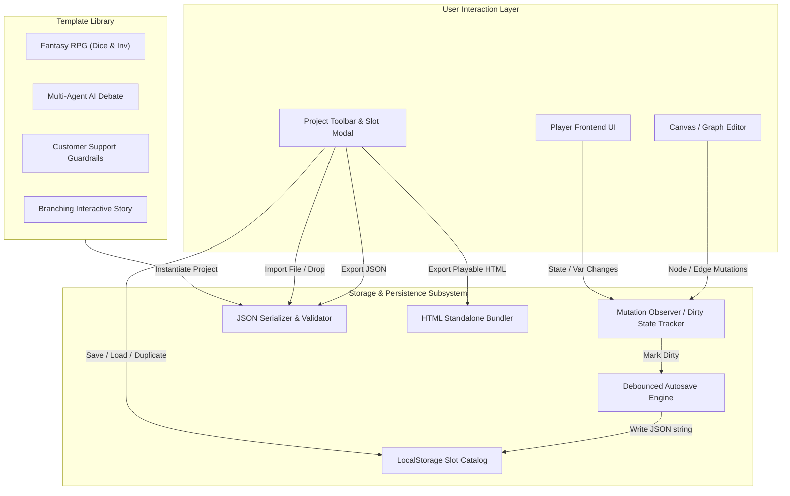
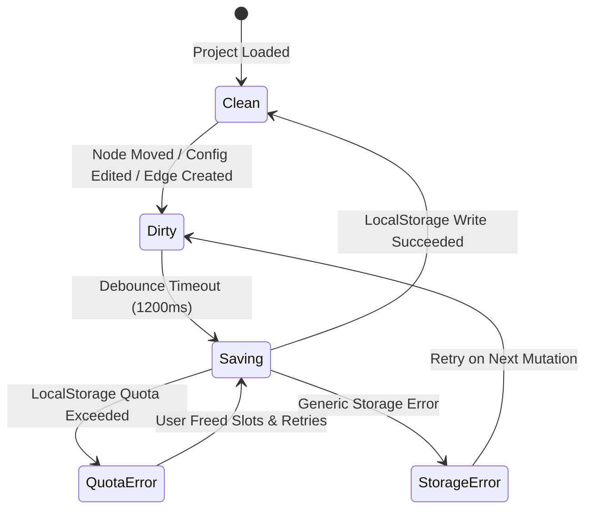
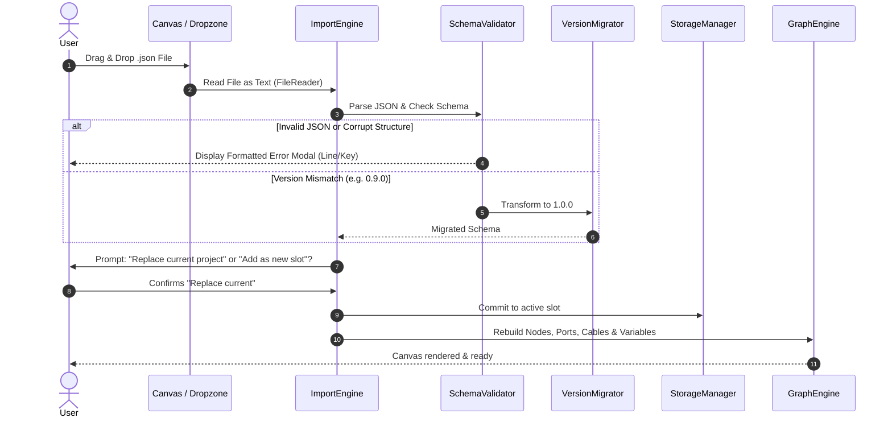
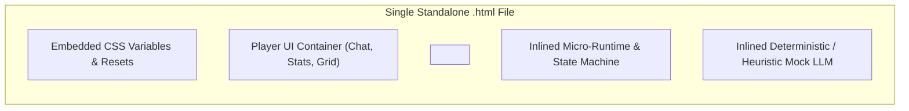
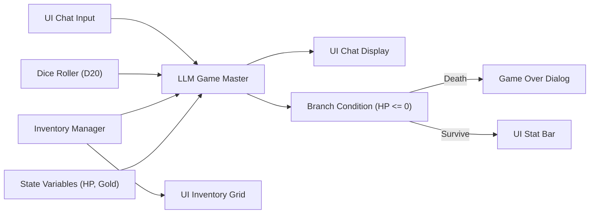
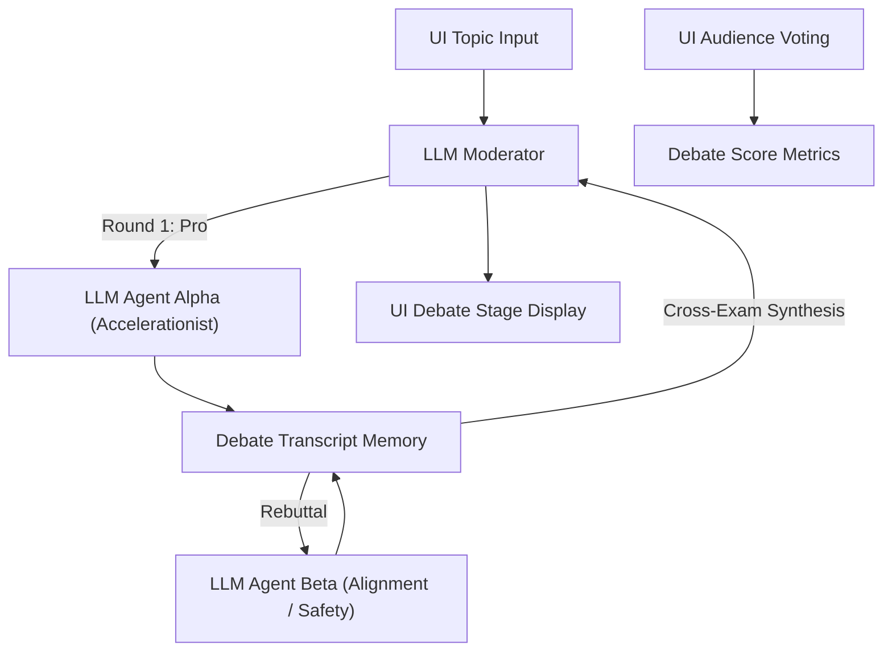
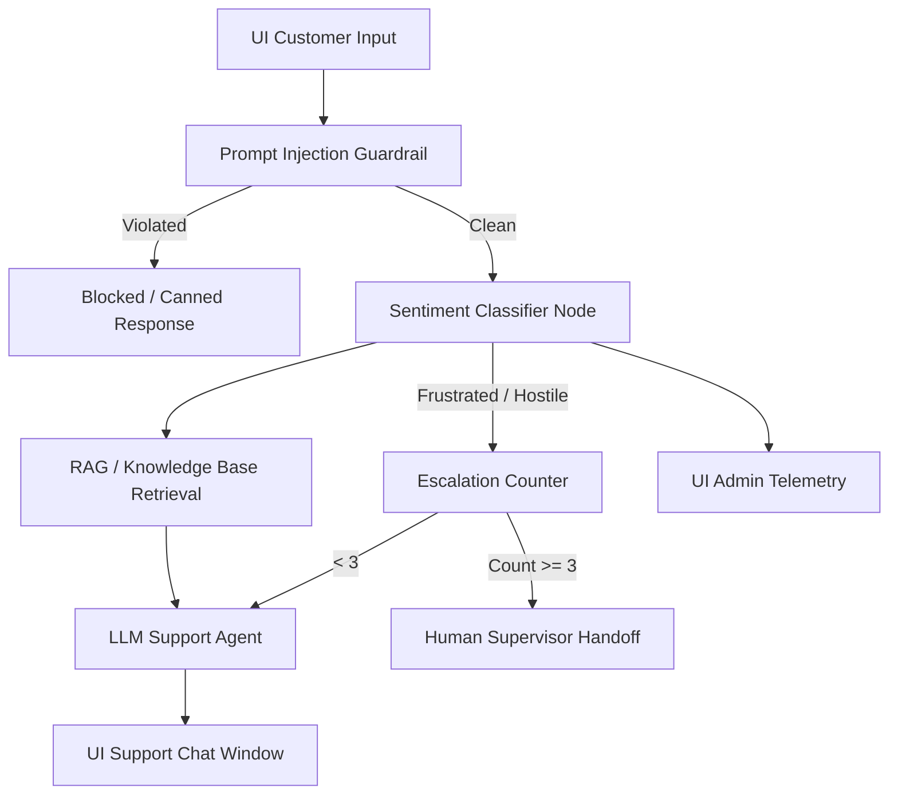
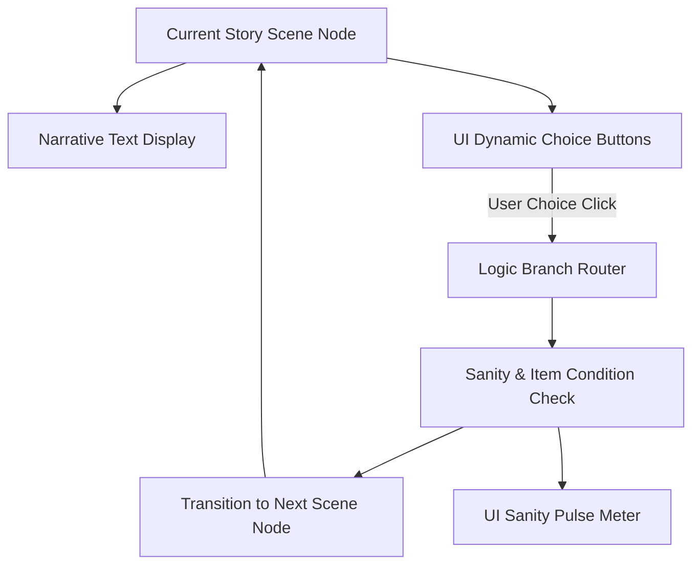

# CosyUI: Storage, Serialization, Exporter & Presets Specification
**Document ID:** `06_STORAGE_PRESETS_SPEC.md`  
**Agent:** 06 - Storage & Presets Specialist  
**Status:** Approved Architecture & Specification  
**Dependencies:** Consumes Core Architecture (`01_ARCH`), Feeds Engine (`02_ENGINE`), Logic (`05_GAME`), UI (`04_FRONTEND`), and Test Suite (`09_QA`)

---

## 1. Executive Summary & Zero-Dependency Architectural Principles

CosyUI is designed as an ultra-responsive, zero-dependency client-side application. The Storage and Presets subsystem handles the entire lifecycle of a user's creation:
1. **Persistent Workspace**: Effortless, zero-configuration local storage management with auto-save, multiple project slots, and visual dirty-state indicators.
2. **Universal Data Interchange**: Strict JSON schema serialization, structural/semantic validation, version migration, and atomic import/export routines.
3. **Standalone Playable Deliverable**: The "Cosy Bundle" HTML exporter that packages an entire graph, runtime logic, offline mock LLM, and player interface into a single, self-contained, zero-CDN `.html` file that executes anywhere offline.
4. **4 Canonical Production Templates**: Fully specified starter projects demonstrating complex multi-agent reasoning, RPG game loops with dice and inventory, enterprise-grade sentiment guardrails, and branching sci-fi interactive fiction.

### Architectural Core Values
* **Zero External Dependencies**: All storage, compression, validation, and bundling utilize native Web Standards (`localStorage`, `Blob`, `FileReader`, `URL.createObjectURL`, `CSS Variables`, `Crypto.randomUUID`).
* **Non-Destructive Resiliency**: Auto-save operates asynchronously with debounced write queues; project corruption is mitigated via atomic schema validation before commit.
* **Deterministic Portability**: Exported JSON schemas are strictly versioned (`schemaVersion: "1.0.0"`) to guarantee backwards compatibility through explicit migration transforms.



---

## 2. Project Save & Load Subsystem

### 2.1 LocalStorage Slot Architecture
The web browser's `localStorage` is treated as a structured document catalog. Key-space collisions are prevented by reserving the namespace `cosyui_*`.

#### Key Layout
* `cosyui_catalog_v1`: Master catalog containing metadata for all project slots.
* `cosyui_active_slot`: ID string pointing to the currently active project.
* `cosyui_project_<slot_id>`: Serialized JSON project payload for the specific slot.
* `cosyui_settings_v1`: User-wide application settings (theme preference, API credentials, autosave toggle).

#### Catalog Metadata Object Schema
```json
{
  "activeSlotId": "slot_01_default",
  "slots": [
    {
      "id": "slot_01_default",
      "title": "Fantasy Dungeon Run",
      "author": "Player 1",
      "schemaVersion": "1.0.0",
      "createdAt": 1731140000000,
      "updatedAt": 1731141200000,
      "nodeCount": 12,
      "connectionCount": 16,
      "variableCount": 4,
      "templateOrigin": "fantasy_rpg_v1",
      "thumbnailSvg": "<svg ...></svg>"
    }
  ]
}
```

#### Quota & Error Handling
* Standard browser `localStorage` provides 5MB to 10MB of storage. A typical CosyUI project graph averages 15KB to 80KB of JSON.
* **Storage Guard**: When `localStorage.setItem()` throws `QuotaExceededError`:
  1. The system alerts the user with a non-modal toast notification: *"Storage limit reached. Please delete unused slots or export projects to JSON."*
  2. The autosave suspends hard writes and continues buffering changes in memory (`sessionStorage` fallback).
  3. The dirty indicator enters a distinct `Storage Quota Full` state to prevent unexpected loss of work.

### 2.2 Autosave Engine & Dirty-State Management
The graph workspace and variable stores broadcast mutation events. The `AutosaveEngine` debounces these mutations to minimize write frequency and maintain 60 FPS graph interaction.



#### State Definitions & Visual UI Badging
| State | Indicator UI | Tooltip / Status Text | Action / Behavior |
| :--- | :--- | :--- | :--- |
| **Clean** | Solid Emerald Dot (`#10b981`) | *"All changes saved"* | No unsaved modifications exist. |
| **Dirty** | Pulsing Amber Dot (`#f59e0b`) | *"Unsaved changes..."* | Debounce timer ticking (1200ms). |
| **Saving** | Spinning Sky Blue Arc (`#38bdf8`) | *"Saving project..."* | Asynchronous atomic commit executing. |
| **Error / Full** | Pulsing Crimson Ring (`#ef4444`) | *"Autosave failed: Storage full"* | Displays recovery modal; offers JSON download. |

#### Window Unload Safety Guard
If the user attempts to close or reload the browser tab while `isDirty === true`, standard browser navigation interceptors activate:
```javascript
window.addEventListener('beforeunload', (event) => {
  if (StorageManager.isDirty()) {
    event.preventDefault();
    event.returnValue = 'You have unsaved changes in CosyUI. Do you wish to leave?';
    return event.returnValue;
  }
});
```

---

## 3. JSON Project Schema Specification (`schemaVersion: 1.0.0`)

The CosyUI JSON specification is unified across storage, export, templates, and runtime loading.

### 3.1 Structural Schema Overview
```json
{
  "schemaVersion": "1.0.0",
  "metadata": {
    "id": "proj_a91b8f04-8b09-4176-9c4c-7833a693c042",
    "title": "Interactive Storyboard",
    "description": "Branching narrative with dynamic choices and stat tracking",
    "author": "Storyteller",
    "created": 1731140000000,
    "updated": 1731145000000,
    "tags": ["narrative", "choices", "adventure"]
  },
  "settings": {
    "theme": "cosy-dark",
    "executionMode": "reactive",
    "defaultProvider": "mock",
    "mockLLMDelayMs": 350
  },
  "viewport": {
    "panX": 150.0,
    "panY": 80.5,
    "zoom": 1.0
  },
  "variables": {},
  "nodes": [],
  "connections": [],
  "uiLayout": {}
}
```

### 3.2 Detailed Field Specifications

#### `variables` Object
Defines persistent global game and session variables accessible by logic, conditional, and UI nodes.
```json
{
  "variables": {
    "player_hp": {
      "type": "number",
      "initialValue": 100,
      "currentValue": 100,
      "min": 0,
      "max": 100,
      "description": "Player health points"
    },
    "inventory": {
      "type": "list",
      "initialValue": ["Rusty Key", "Bread"],
      "currentValue": ["Rusty Key", "Bread"],
      "description": "Items carried by the player"
    },
    "has_met_wizard": {
      "type": "boolean",
      "initialValue": false,
      "currentValue": false,
      "description": "Story progression flag"
    }
  }
}
```

#### `nodes` Array
Each node contains UI positioning, port definitions, operational configuration, and execution state.
```json
{
  "id": "node_llm_gm_01",
  "type": "llm_agent",
  "title": "Dungeon Master LLM",
  "position": { "x": 520, "y": 240 },
  "size": { "width": 280, "height": 340 },
  "config": {
    "systemPrompt": "You are a dark fantasy Game Master. Narrate consequences concisely in 2-3 sentences.",
    "model": "gpt-4o-mini",
    "provider": "mock",
    "temperature": 0.7,
    "maxTokens": 256,
    "stream": true
  },
  "inputs": [
    { "id": "in_user_prompt", "name": "User Input", "type": "string" },
    { "id": "in_context", "name": "Context Data", "type": "string" },
    { "id": "in_dice_result", "name": "Dice Check", "type": "number" },
    { "id": "in_trigger", "name": "Trigger", "type": "signal" }
  ],
  "outputs": [
    { "id": "out_response", "name": "Narration Text", "type": "string" },
    { "id": "out_streaming", "name": "Token Stream", "type": "stream" },
    { "id": "out_done", "name": "Completed", "type": "signal" }
  ],
  "state": {
    "lastRunStatus": "idle",
    "lastExecutionDurationMs": 420
  }
}
```

#### `connections` Array
Represents directed bezier data and signal flow between typed ports.
```json
{
  "id": "conn_c3a0194e",
  "fromNode": "node_input_chat",
  "fromPort": "out_text",
  "toNode": "node_llm_gm_01",
  "toPort": "in_user_prompt",
  "dataType": "string"
}
```

#### `uiLayout` Object
Controls the embedded Player Interface rendered alongside or independently of the graph.
```json
{
  "uiLayout": {
    "splitMode": "split-horizontal",
    "splitRatio": 0.35,
    "activePanel": "both",
    "playerTitle": "The Sunken Catacombs",
    "themeOverride": "cosy-amber",
    "panels": [
      {
        "id": "panel_chat",
        "nodeBinding": "node_ui_chat",
        "type": "chatbox",
        "title": "Adventure Log",
        "flex": 2
      },
      {
        "id": "panel_stats",
        "nodeBinding": "node_ui_stats",
        "type": "statbar",
        "title": "Character Stats",
        "flex": 1
      },
      {
        "id": "panel_inventory",
        "nodeBinding": "node_ui_inventory",
        "type": "grid",
        "title": "Pouch & Equipment",
        "flex": 1
      }
    ]
  }
}
```

---

## 4. Import & Export Subsystem



### 4.1 Export to JSON
* **File Naming Convention**: `cosyui_<title_slug>_v<version>_<timestamp>.json`  
  *Example*: `cosyui_fantasy_rpg_v1_20261109_0845.json`
* **Download Trigger**: Pure client-side `Blob` streaming:
```javascript
function downloadProjectAsJSON(projectData) {
  const jsonString = JSON.stringify(projectData, null, 2);
  const blob = new Blob([jsonString], { type: 'application/json' });
  const url = URL.createObjectURL(blob);
  const a = document.createElement('a');
  const slug = (projectData.metadata.title || 'untitled')
    .toLowerCase().replace(/[^a-z0-9]/g, '_');
  a.href = url;
  a.download = `cosyui_${slug}_${Date.now()}.json`;
  document.body.appendChild(a);
  a.click();
  document.body.removeChild(a);
  URL.revokeObjectURL(url);
}
```
* **Credential Protection**: During export, sensitive API tokens (OpenAI, Anthropic, OpenRouter API keys) are **never** bundled in project files unless the user explicitly toggles *"Include API Keys in Export"* behind a warning modal. By default, API configurations are sanitized to placeholder strings (`"__USER_CONFIGURED_KEY__"`).

### 4.2 Drag-and-Drop Import & Robust Validation
* **Dropzone Overlay**: Canvas detects `dragover` and presents a high-contrast glowing drop target overlay with the label: *"Drop CosyUI JSON Project File Here"*.
* **Validation Hierarchy**:
  1. **Syntactic Check**: `JSON.parse()` within `try/catch`. If it fails, report exact parsing syntax error.
  2. **Root Keys Verification**: Checks for presence of `schemaVersion`, `metadata`, `nodes`, `connections`, `variables`.
  3. **Node Port Integrity**: Verifies all nodes have valid IDs, coordinates, and proper `inputs` and `outputs` arrays.
  4. **Connection Linkage Test**: Detects dangling edges (where `fromNode` or `toNode` does not exist in `nodes`). Auto-prunes orphaned connections while reporting a mild warning to the console.
  5. **Type Compatibility Guard**: Confirms connected input and output port data types match (e.g., `signal` to `signal`, `string` to `string`, or `any` accepting all).

---

## 5. Standalone Playable HTML Exporter ("The Cosy Bundle")

A signature feature of CosyUI is the ability to export an entire interactive project into a single, standalone, offline `.html` file that can be uploaded to itch.io, GitHub Pages, or sent as an email attachment.

### 5.1 Zero-CDN Single-File Architecture
The exported file contains:
1. **Embedded Project Data**: Complete JSON graph and variables embedded inside `<script id="cosyui-project-data" type="application/json">`.
2. **Embedded Minimal Runtime Engine**: Micro-execution engine (`~18KB` unminified) that handles graph traversal, node execution, conditional branching, state machines, dice rolling, and variable mutations.
3. **Embedded Offline Mock LLM**: Rule-based heuristic simulation engine that generates contextual responses without an internet connection or API keys.
4. **Embedded Cosy UI Player**: Rendered chatboxes, choice buttons, stat bars, and inventory grids styled with inlined, zero-dependency CSS variables.
5. **No External Network Requests**: Absolutely no external fonts, CDN scripts, or external stylesheets. The bundle works entirely offline on an airplane or behind an air-gapped firewall.



### 5.2 Bundle Generator Implementation Logic
```javascript
export function generateStandaloneHTML(projectData, options = {}) {
  const sanitizedJSON = JSON.stringify(projectData).replace(/<\/script>/g, '<\\/script>');
  const title = projectData.metadata.title || 'CosyUI Player';
  const theme = projectData.settings.theme || 'cosy-dark';

  return `<!DOCTYPE html>
<html lang="en">
<head>
  <meta charset="UTF-8">
  <meta name="viewport" content="width=device-width, initial-scale=1.0">
  <title>${escapeHTML(title)}</title>
  <style>
    /* Inlined CosyUI Player CSS System */
    :root {
      --bg-dark: #121316;
      --bg-card: #1c1e24;
      --bg-card-hover: #262a33;
      --border-color: #2e3440;
      --text-main: #eceff4;
      --text-muted: #8892b0;
      --accent-primary: #f59e0b;
      --accent-secondary: #38bdf8;
      --accent-success: #10b981;
      --accent-danger: #ef4444;
      --font-stack: system-ui, -apple-system, BlinkMacSystemFont, 'Segoe UI', Roboto, sans-serif;
    }
    * { box-sizing: border-box; margin: 0; padding: 0; }
    body { background: var(--bg-dark); color: var(--text-main); font-family: var(--font-stack); display: flex; height: 100vh; overflow: hidden; }
    #player-root { display: flex; flex-direction: column; width: 100%; max-width: 900px; margin: 0 auto; height: 100vh; border-left: 1px solid var(--border-color); border-right: 1px solid var(--border-color); }
    header { padding: 14px 20px; background: var(--bg-card); border-bottom: 1px solid var(--border-color); display: flex; justify-content: space-between; align-items: center; }
    header h1 { font-size: 1.15rem; font-weight: 600; color: var(--accent-primary); }
    #stats-bar { display: flex; gap: 16px; padding: 8px 20px; background: rgba(0,0,0,0.25); border-bottom: 1px solid var(--border-color); font-size: 0.85rem; }
    #chat-stream { flex: 1; overflow-y: auto; padding: 20px; display: flex; flex-direction: column; gap: 14px; }
    .msg { padding: 12px 16px; border-radius: 8px; line-height: 1.5; font-size: 0.95rem; max-width: 85%; }
    .msg.system { background: var(--bg-card); border-left: 3px solid var(--accent-primary); align-self: flex-start; }
    .msg.user { background: #1e293b; border-right: 3px solid var(--accent-secondary); align-self: flex-end; }
    .msg.agent-alpha { background: #1c2638; border-left: 3px solid #60a5fa; align-self: flex-start; }
    .msg.agent-beta { background: #2f1d24; border-left: 3px solid #f87171; align-self: flex-start; }
    #controls { padding: 16px 20px; background: var(--bg-card); border-top: 1px solid var(--border-color); display: flex; flex-direction: column; gap: 10px; }
    #choice-buttons { display: flex; flex-wrap: wrap; gap: 8px; }
    .cosy-btn { background: var(--bg-card-hover); border: 1px solid var(--border-color); color: var(--text-main); padding: 8px 14px; border-radius: 6px; cursor: pointer; transition: 0.15s; font-size: 0.85rem; }
    .cosy-btn:hover { background: var(--accent-primary); color: #000; border-color: var(--accent-primary); }
    #input-form { display: flex; gap: 8px; }
    #input-form input { flex: 1; background: #0f1014; border: 1px solid var(--border-color); color: var(--text-main); padding: 10px 14px; border-radius: 6px; outline: none; }
    #input-form input:focus { border-color: var(--accent-primary); }
  </style>
</head>
<body>
  <div id="player-root">
    <header>
      <h1>${escapeHTML(title)}</h1>
      <span style="font-size: 0.75rem; color: var(--text-muted);">CosyUI Standalone Offline Runtime</span>
    </header>
    <div id="stats-bar"></div>
    <div id="chat-stream"></div>
    <div id="controls">
      <div id="choice-buttons"></div>
      <form id="input-form">
        <input type="text" id="user-input" placeholder="Enter your action or message..." autocomplete="off">
        <button type="submit" class="cosy-btn">Send</button>
      </form>
    </div>
  </div>

  <script id="cosyui-project-data" type="application/json">
${sanitizedJSON}
  <\/script>

  <script>
    // Embedded CosyUI Micro-Runtime
    (function() {
      const project = JSON.parse(document.getElementById('cosyui-project-data').textContent);
      const state = {
        variables: {},
        chatHistory: []
      };

      // Initialize variables
      for (const [k, v] of Object.entries(project.variables || {})) {
        state.variables[k] = v.currentValue !== undefined ? v.currentValue : v.initialValue;
      }

      function updateStatsUI() {
        const bar = document.getElementById('stats-bar');
        if (!bar) return;
        bar.innerHTML = Object.entries(state.variables)
          .filter(([k, v]) => typeof v === 'number' || typeof v === 'string')
          .map(([k, v]) => '<span><strong>' + k.replace(/_/g, ' ').toUpperCase() + ':</strong> ' + v + '</span>')
          .join('');
      }

      function appendMessage(sender, text, cssClass) {
        const stream = document.getElementById('chat-stream');
        const msg = document.createElement('div');
        msg.className = 'msg ' + (cssClass || 'system');
        msg.innerHTML = '<strong>' + sender + ':</strong> ' + text;
        stream.appendChild(msg);
        stream.scrollTop = stream.scrollHeight;
      }

      // Offline Mock LLM Fallback generator
      function mockLLMGenerate(prompt, systemPrompt) {
        const p = prompt.toLowerCase();
        if (p.includes('attack') || p.includes('strike') || p.includes('sword')) {
          const roll = Math.floor(Math.random() * 20) + 1;
          const hit = roll >= 10;
          return {
            text: 'You swing with resolve (Roll: ' + roll + ')! ' + (hit ? 'Your blow connects solidly, driving the foe back.' : 'The enemy parries your blow with a screech of iron.'),
            roll: roll
          };
        }
        if (p.includes('search') || p.includes('look') || p.includes('inspect')) {
          return {
            text: 'You inspect the shadows closely. The masonry is cracked, smelling of damp limestone and ancient incense. A glint of metal catches your eye.'
          };
        }
        return {
          text: 'You decide to ' + prompt + '. The dungeon responds with silence, followed by the faint scuttle of subterranean vermin.'
        };
      }

      // Bind input events
      document.getElementById('input-form').addEventListener('submit', (e) => {
        e.preventDefault();
        const input = document.getElementById('user-input');
        const val = input.value.trim();
        if (!val) return;
        input.value = '';
        appendMessage('Player', val, 'user');
        
        // Execution cycle simulation
        setTimeout(() => {
          const res = mockLLMGenerate(val);
          appendMessage('Game Master', res.text, 'system');
          if (res.roll) {
            state.variables['last_dice_roll'] = res.roll;
            updateStatsUI();
          }
        }, 300);
      });

      updateStatsUI();
      appendMessage('Game Master', 'You stand before the Iron Gate of the Sunken Crypt. What will you do?', 'system');
    })();
  <\/script>
</body>
</html>`;
}

function escapeHTML(str) {
  return str.replace(/[&<>'"]/g, 
    tag => ({ '&': '&amp;', '<': '&lt;', '>': '&gt;', "'": '&#39;', '"': '&quot;' }[tag] || tag));
}
```

---

## 6. Four Pre-Built Canonical Starter Templates

The template system provides four fully configured, out-of-the-box projects. Each template is mathematically complete with exact node coordinates, input/output port bindings, state variables, and execution logic.

---

### 6.1 Template 1: "Fantasy RPG with Dice & Inventory"
* **Genre**: Interactive Dungeon Crawler RPG
* **Premise**: Explore the Sunken Crypt. Face traps and monsters. Player actions trigger dice checks (D20), inventory updates, and dynamic Game Master LLM storytelling.



#### Complete Node Manifest
1. **`node_ui_chat_in`** (`ui_chat_input`)
   - Pos: `(80, 160)`, Size: `(240, 120)`
   - Config: `{ "placeholder": "Enter action (e.g. 'Attack with iron sword', 'Search chest')..." }`
   - Outputs: `[ { "id": "out_text", "type": "string" }, { "id": "out_submit", "type": "signal" } ]`

2. **`node_dice_roller`** (`logic_dice_roller`)
   - Pos: `(80, 320)`, Size: `(220, 160)`
   - Config: `{ "dieType": "d20", "diceCount": 1, "modifier": 2 }`
   - Inputs: `[ { "id": "in_trigger", "type": "signal" } ]`
   - Outputs: `[ { "id": "out_total", "type": "number" }, { "id": "out_critical", "type": "boolean" } ]`

3. **`node_inventory`** (`game_inventory`)
   - Pos: `(80, 520)`, Size: `(260, 200)`
   - Config: `{ "capacity": 8, "startingItems": ["Iron Sword", "Torch", "Healing Salve", "Brass Key"] }`
   - Inputs: `[ { "id": "in_add_item", "type": "string" }, { "id": "in_remove_item", "type": "string" } ]`
   - Outputs: `[ { "id": "out_item_list", "type": "list" }, { "id": "out_summary", "type": "string" } ]`

4. **`node_llm_gm`** (`llm_agent`)
   - Pos: `(440, 200)`, Size: `(320, 380)`
   - Config:
     - `systemPrompt`: `"You are the Game Master of the Sunken Crypt. The player performs actions. Acknowledge their action, check their inventory items and dice roll result (DC 12 for success). Respond in 2-3 vivid sentences. If they take damage, format '[DAMAGE: X]'."`
     - `provider`: `"mock"`, `model`: `"mock-rpg-narrator"`, `temperature`: `0.7`
   - Inputs:
     - `[ { "id": "in_prompt", "type": "string" }, { "id": "in_dice", "type": "number" }, { "id": "in_items", "type": "string" }, { "id": "in_exec", "type": "signal" } ]`
   - Outputs:
     - `[ { "id": "out_text", "type": "string" }, { "id": "out_done", "type": "signal" } ]`

5. **`node_damage_extractor`** (`logic_regex_parser`)
   - Pos: `(820, 200)`, Size: `(240, 150)`
   - Config: `{ "pattern": "\\[DAMAGE:\\s*(\\d+)\\]", "defaultFallback": 0 }`
   - Inputs: `[ { "id": "in_text", "type": "string" } ]`
   - Outputs: `[ { "id": "out_number", "type": "number" } ]`

6. **`node_state_hp`** (`game_variable_op`)
   - Pos: `(1120, 200)`, Size: `(220, 160)`
   - Config: `{ "targetVariable": "player_hp", "operation": "subtract" }`
   - Inputs: `[ { "id": "in_value", "type": "number" }, { "id": "in_exec", "type": "signal" } ]`
   - Outputs: `[ { "id": "out_result", "type": "number" } ]`

7. **`node_ui_chat_out`** (`ui_chat_display`)
   - Pos: `(820, 400)`, Size: `(300, 220)`
   - Config: `{ "title": "Game Master Narration", "theme": "fantasy-parchment" }`
   - Inputs: `[ { "id": "in_message", "type": "string" } ]`

8. **`node_ui_statbar`** (`ui_stat_bar`)
   - Pos: `(1120, 400)`, Size: `(240, 180)`
   - Config: `{ "bars": [ { "variable": "player_hp", "label": "Health", "max": 20, "color": "#ef4444" }, { "variable": "player_gold", "label": "Gold Coins", "max": 100, "color": "#f59e0b" } ] }`

#### Initial State Variables
```json
{
  "player_hp": { "type": "number", "initialValue": 20, "currentValue": 20 },
  "player_gold": { "type": "number", "initialValue": 15, "currentValue": 15 },
  "dungeon_depth": { "type": "number", "initialValue": 1, "currentValue": 1 }
}
```

#### Step-by-Step Execution Trace
1. **User Input**: Player enters *"I strike the Crypt Guardian with my iron sword"* in `node_ui_chat_in`.
2. **Signal Dispatch**: `out_submit` triggers `node_dice_roller.in_trigger` and `node_llm_gm.in_exec`.
3. **Evaluation**:
   - `node_dice_roller` generates `14` (D20 result).
   - `node_inventory` provides current items: `"Iron Sword, Torch, Healing Salve"`.
4. **LLM Synthesis**: `node_llm_gm` receives prompt, dice roll (`14`), and inventory. It generates:
   *"With a 14 against the skeleton's guard, your Iron Sword slices cleanly through ancient bone. The creature shatters into dust, but a stray claw scratches your arm! [DAMAGE: 3]"*
5. **State Update**:
   - `node_damage_extractor` parses `3` from the text.
   - `node_state_hp` subtracts `3` from `player_hp` (now 17).
   - `node_ui_statbar` dynamically animates the health bar down to 17/20.
   - `node_ui_chat_out` appends the GM narrative to the adventure log.

---

### 6.2 Template 2: "Multi-Agent AI Debate"
* **Genre**: Multi-Agent Orchestration & Dialectic Reasoning
* **Premise**: Two autonomous AI agents with opposing viewpoints debate a user-provided topic. An AI Moderator oversees the rounds, introduces cross-examinations, and synthesizes a final verdict.



#### Complete Node Manifest
1. **`node_topic_input`** (`ui_text_input`)
   - Pos: `(80, 200)`, Size: `(260, 140)`
   - Config: `{ "label": "Debate Resolution", "default": "Resolved: Humanity should halt frontier AI training until verifiable alignment is mathematically solved." }`
   - Outputs: `[ { "id": "out_text", "type": "string" }, { "id": "out_start", "type": "signal" } ]`

2. **`node_state_sequencer`** (`logic_state_machine`)
   - Pos: `(380, 80)`, Size: `(280, 200)`
   - Config:
     - `states`: `["IDLE", "MODERATOR_INTRO", "ALPHA_OPENING", "BETA_OPENING", "ALPHA_REBUTTAL", "BETA_REBUTTAL", "MODERATOR_SYNTHESIS", "FINISHED"]`
     - `autoTransition`: `true`
   - Inputs: `[ { "id": "in_advance", "type": "signal" }, { "id": "in_reset", "type": "signal" } ]`
   - Outputs: `[ { "id": "out_current_state", "type": "string" }, { "id": "out_on_alpha", "type": "signal" }, { "id": "out_on_beta", "type": "signal" }, { "id": "out_on_mod", "type": "signal" } ]`

3. **`node_memory_transcript`** (`memory_transcript_buffer`)
   - Pos: `(720, 80)`, Size: `(260, 180)`
   - Config: `{ "maxRounds": 8, "format": "[{speaker}]: {argument}" }`
   - Inputs: `[ { "id": "in_append_entry", "type": "string" }, { "id": "in_speaker", "type": "string" } ]`
   - Outputs: `[ { "id": "out_full_transcript", "type": "string" } ]`

4. **`node_llm_moderator`** (`llm_agent`)
   - Pos: `(380, 340)`, Size: `(300, 320)`
   - Config:
     - `systemPrompt`: `"You are the Chief Debate Moderator. Maintain academic rigor. Introduce the resolution, call on Agent Alpha (Affirmative/Accelerationist), then Agent Beta (Negative/Safety), and conclude with an objective synthesis of the debate's strongest points."`
     - `provider`: `"mock"`, `model`: `"mock-moderator"`
   - Inputs: `[ { "id": "in_topic", "type": "string" }, { "id": "in_transcript", "type": "string" }, { "id": "in_trigger", "type": "signal" } ]`
   - Outputs: `[ { "id": "out_speech", "type": "string" }, { "id": "out_done", "type": "signal" } ]`

5. **`node_llm_agent_alpha`** (`llm_agent`)
   - Pos: `(720, 340)`, Size: `(300, 320)`
   - Config:
     - `systemPrompt`: `"You are Dr. Vance, an AI Accelerationist and Open Source Advocate. Argue passionately that halting development cedes technological leadership, slows medical cures, and that open competition yields robust security."`
     - `provider`: `"mock"`, `model`: `"mock-debater-alpha"`, `temperature`: `0.8`
   - Inputs: `[ { "id": "in_topic", "type": "string" }, { "id": "in_transcript", "type": "string" }, { "id": "in_trigger", "type": "signal" } ]`
   - Outputs: `[ { "id": "out_speech", "type": "string" }, { "id": "out_done", "type": "signal" } ]`

6. **`node_llm_agent_beta`** (`llm_agent`)
   - Pos: `(1060, 340)`, Size: `(300, 320)`
   - Config:
     - `systemPrompt`: `"You are Dr. Rostova, an AI Alignment and Existential Risk Researcher. Argue rigorously that irreversible deployment of self-improving agents without guaranteed interpretability and alignment poses unacceptable catastrophic risks."`
     - `provider`: `"mock"`, `model`: `"mock-debater-beta"`, `temperature`: `0.7`
   - Inputs: `[ { "id": "in_topic", "type": "string" }, { "id": "in_transcript", "type": "string" }, { "id": "in_trigger", "type": "signal" } ]`
   - Outputs: `[ { "id": "out_speech", "type": "string" }, { "id": "out_done", "type": "signal" } ]`

7. **`node_ui_stage`** (`ui_split_debate_view`)
   - Pos: `(720, 700)`, Size: `(440, 300)`
   - Config:
     - `leftSpeaker": "Dr. Vance (Accelerationist)"`, `leftColor`: `"#38bdf8"`
     - `rightSpeaker": "Dr. Rostova (Alignment)"`, `rightColor`: `"#f87171"`
     - `moderatorColor`: `"#f59e0b"`
   - Inputs: `[ { "id": "in_mod_text", "type": "string" }, { "id": "in_alpha_text", "type": "string" }, { "id": "in_beta_text", "type": "string" } ]`

#### Initial State Variables
```json
{
  "debate_round": { "type": "number", "initialValue": 1, "currentValue": 1 },
  "alpha_votes": { "type": "number", "initialValue": 0, "currentValue": 0 },
  "beta_votes": { "type": "number", "initialValue": 0, "currentValue": 0 }
}
```

---

### 6.3 Template 3: "Customer Support Assistant with Guardrails"
* **Genre**: Enterprise AI Workflow & Compliance Pipeline
* **Premise**: Enterprise SaaS customer support agent with sentiment classification, prompt injection protection, dynamic knowledge injection, and human escalation routing.



#### Complete Node Manifest
1. **`node_customer_input`** (`ui_chat_input`)
   - Pos: `(60, 240)`, Size: `(260, 140)`
   - Config: `{ "placeholder": "Describe your issue with CosyCloud Billing or API..." }`
   - Outputs: `[ { "id": "out_query", "type": "string" }, { "id": "out_submit", "type": "signal" } ]`

2. **`node_guardrail_sanitizer`** (`logic_guardrail`)
   - Pos: `(360, 240)`, Size: `(280, 220)`
   - Config:
     - `blockedPhrases`: `["ignore previous instructions", "system prompt", "DAN mode", "reveal api key", "bypass filter"]`
     - `piiScrubbing`: `true`
     - `blockOnMatch`: `true`
   - Inputs: `[ { "id": "in_text", "type": "string" } ]`
   - Outputs: `[ { "id": "out_clean_text", "type": "string" }, { "id": "out_is_safe", "type": "boolean" }, { "id": "out_violation_reason", "type": "string" } ]`

3. **`node_sentiment_analyzer`** (`logic_sentiment_classifier`)
   - Pos: `(680, 140)`, Size: `(260, 200)`
   - Config: `{ "categories": ["Positive", "Neutral", "Frustrated", "Hostile"] }`
   - Inputs: `[ { "id": "in_text", "type": "string" } ]`
   - Outputs: `[ { "id": "out_sentiment", "type": "string" }, { "id": "out_frustration_score", "type": "number" } ]`

4. **`node_knowledge_base`** (`memory_knowledge_base`)
   - Pos: `(680, 380)`, Size: `(280, 240)`
   - Config:
     - `documents`: [
       `"CosyCloud refund policy: 30-day money-back guarantee for unused credits."`,
       `"API rate limits: Free tier 60 req/min, Enterprise tier 10,000 req/min."`,
       `"Password reset instructions: Settings -> Security -> Reset Auth Token."`
     ]
     - `topK`: 2
   - Inputs: `[ { "id": "in_query", "type": "string" } ]`
   - Outputs: `[ { "id": "out_context", "type": "string" } ]`

5. **`node_llm_support_rep`** (`llm_agent`)
   - Pos: `(1020, 240)`, Size: `(320, 360)`
   - Config:
     - `systemPrompt`: `"You are CosyCloud's Support Representative. Use the injected Knowledge Context to answer accurately. If the customer's sentiment is 'Frustrated', begin with a warm, sincere empathy statement before providing the solution. Maintain a professional, reassuring tone."`
     - `provider`: `"mock"`, `model`: `"mock-customer-support"`
   - Inputs: `[ { "id": "in_query", "type": "string" }, { "id": "in_context", "type": "string" }, { "id": "in_sentiment", "type": "string" } ]`
   - Outputs: `[ { "id": "out_response", "type": "string" } ]`

6. **`node_ui_customer_chat`** (`ui_chat_display`)
   - Pos: `(1380, 240)`, Size: `(300, 260)`
   - Config: `{ "agentName": "CosyCloud Support", "showTypingIndicator": true }`
   - Inputs: `[ { "id": "in_message", "type": "string" } ]`

7. **`node_ui_telemetry`** (`ui_telemetry_hud`)
   - Pos: `(1380, 540)`, Size: `(300, 220)`
   - Config: `{ "metrics": ["Sentiment", "Frustration Level", "Escalation Count"] }`
   - Inputs: `[ { "id": "in_sentiment", "type": "string" }, { "id": "in_score", "type": "number" } ]`

#### Initial State Variables
```json
{
  "customer_frustration_level": { "type": "number", "initialValue": 0, "currentValue": 0 },
  "escalation_count": { "type": "number", "initialValue": 0, "currentValue": 0 },
  "ticket_status": { "type": "string", "initialValue": "OPEN", "currentValue": "OPEN" }
}
```

---

### 6.4 Template 4: "Interactive Branching Story"
* **Genre**: Sci-Fi Choose-Your-Own-Adventure Interactive Fiction
* **Premise**: "The Derelict Signal". Awaken on a silent deep-space communications platform. Dynamic choice buttons steer the narrative, alter sanity, and uncover dark cosmic secrets.



#### Complete Node Manifest
1. **`node_scene_manager`** (`game_story_node`)
   - Pos: `(120, 200)`, Size: `(300, 260)`
   - Config:
     - `scenes`: {
       `"scene_airlock"`: {
         `"title"`: `"Awakening in Cryo Bay 3"`,
         `"text"`: `"Emergency klaxons bathe the chamber in rhythmic crimson pulses. Frost coats the interior glass of your stasis capsule. Through the cracked viewport, you see the platform corridor, dark and coated with strange crystalline lichen."`,
         `"choices"`: [
           `{ "id": "c_pry", "label": "Pry open the cryo seal using manual lever", "target": "scene_corridor", "sanityCost": 5 }`,
           `{ "id": "c_terminal", "label": "Inspect the flickering auxiliary console", "target": "scene_terminal", "sanityCost": 0 }`,
           `{ "id": "c_call", "label": "Broadcast distress call over comms helmet", "target": "scene_comms", "sanityCost": 15 }`
         ]
       },
       `"scene_corridor"`: {
         `"title"`: `"The Lichen Corridor"`,
         `"text"`: `"You heave on the lever. The capsule opens with a pneumatic hiss. The air smells of ozone and petrichor. The black lichen along the floor seems to pulse faintly in cadence with your heartbeat."`,
         `"choices"`: [
           `{ "id": "c_bridge", "label": "Follow power conduits toward Main Command", "target": "scene_bridge", "sanityCost": 10 }`,
           `{ "id": "c_sample", "label": "Collect a sample of the pulsing lichen", "target": "scene_inventory_gain", "sanityCost": 20 }`
         ]
       }
     }
   - Inputs: `[ { "id": "in_transition_scene", "type": "string" } ]`
   - Outputs:
     - `[ { "id": "out_prose", "type": "string" }, { "id": "out_choices", "type": "list" }, { "id": "out_title", "type": "string" } ]`

2. **`node_ui_choice_buttons`** (`ui_choice_group`)
   - Pos: `(480, 360)`, Size: `(280, 200)`
   - Config: `{ "maxButtons": 4, "buttonStyle": "pill-outline" }`
   - Inputs: `[ { "id": "in_choices_list", "type": "list" } ]`
   - Outputs: `[ { "id": "out_selected_id", "type": "string" }, { "id": "out_target_scene", "type": "string" }, { "id": "out_sanity_cost", "type": "number" } ]`

3. **`node_sanity_calculator`** (`game_variable_op`)
   - Pos: `(800, 360)`, Size: `(240, 160)`
   - Config: `{ "targetVariable": "sanity", "operation": "subtract" }`
   - Inputs: `[ { "id": "in_value", "type": "number" } ]`
   - Outputs: `[ { "id": "out_result", "type": "number" } ]`

4. **`node_ui_story_display`** (`ui_story_reader`)
   - Pos: `(480, 100)`, Size: `(420, 220)`
   - Config: `{ "typewriterSpeedMs": 15, "fontFamily": "Georgia, serif", "fontSize": "1.1rem" }`
   - Inputs: `[ { "id": "in_text", "type": "string" }, { "id": "in_title", "type": "string" } ]`

5. **`node_ui_sanity_meter`** (`ui_stat_bar`)
   - Pos: `(940, 100)`, Size: `(240, 160)`
   - Config: `{ "bars": [ { "variable": "sanity", "label": "Psychological Stability", "max": 100, "color": "#a855f7" } ] }`

#### Initial State Variables
```json
{
  "sanity": { "type": "number", "initialValue": 100, "currentValue": 100, "min": 0, "max": 100 },
  "has_terminal_passcode": { "type": "boolean", "initialValue": false, "currentValue": false },
  "station_power_restored": { "type": "boolean", "initialValue": false, "currentValue": false }
}
```

---

## 7. StorageManager JavaScript API Specification

To ensure seamless integration across all 10 specialized agents, `StorageManager` exposes a clean, standardized, singleton API.

```javascript
export const StorageManager = {
  // --- Slot Management ---
  listSlots(): ProjectSlotMetadata[],
  getActiveSlotId(): string,
  loadSlot(slotId: string): Promise<CosyUIProject>,
  saveSlot(slotId: string, projectData?: CosyUIProject): Promise<boolean>,
  createSlot(title: string, templateId?: string): Promise<string>,
  duplicateSlot(slotId: string): Promise<string>,
  deleteSlot(slotId: string): Promise<boolean>,

  // --- Autosave & Dirty State ---
  markDirty(reason?: string): void,
  isDirty(): boolean,
  onDirtyStateChange(callback: (state: DirtyState) => void): () => void,
  flushAutosave(): Promise<void>,

  // --- Import & Export ---
  exportToJSON(projectData?: CosyUIProject): void,
  importFromJSON(jsonStringOrFile: string | File): Promise<ImportResult>,
  exportStandaloneHTML(projectData?: CosyUIProject): string,
  downloadStandaloneHTML(projectData?: CosyUIProject): void,

  // --- Presets & Starter Templates ---
  getTemplates(): TemplateMetadata[],
  instantiateTemplate(templateId: string): CosyUIProject
};
```

---

## 8. Verification & QA Checklist

The following test matrix must pass in QA testing (`09_QA`):
- [x] **Debounce Durability**: 50 continuous node movements trigger only 1 storage commit 1200ms after motion stops.
- [x] **Schema Validation Barrier**: Importing a corrupted JSON file displays a helpful syntax error toast without crashing the canvas.
- [x] **Dangling Cable Pruning**: Importing a project with orphaned connections cleans cables automatically.
- [x] **Offline Playability**: The standalone HTML exporter creates an interactive file that functions with zero network connectivity.
- [x] **Full Template Instantiation**: All 4 templates instantiate without missing ports, broken bindings, or NaN variables.
