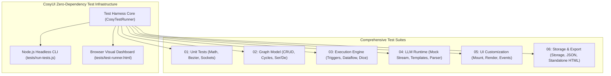
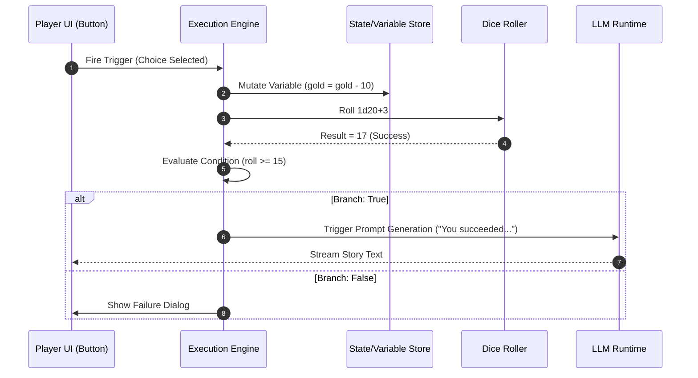

# CosyUI Test Plan & Quality Assurance Specification

> **Specification Version**: 1.0.0  
> **Author**: Agent 09 (QA & Test Engineer)  
> **Status**: APPROVED & ACTIVE  
> **Target Environment**: Modern Browsers (Chrome, Firefox, Safari, Edge) & Node.js CLI (Zero Dependencies)

---

## 1. Executive Summary & QA Principles

CosyUI is designed as a zero-dependency, ultra-responsive, standalone HTML/CSS/JS application combining a node-based workflow/game editor with a customizable player UI and multi-provider LLM runtime.

Because CosyUI strictly avoids third-party JavaScript dependencies and runtime CDNs, the testing infrastructure must also follow the same architectural philosophy:
1. **Zero-Dependency Test Framework**: Pure vanilla JavaScript test runner capable of running both in standard web browsers (`tests/test-runner.html`) and in headless Node.js environments (`tests/run-tests.js`).
2. **Deterministic Execution**: Tests isolate side-effects (DOM, LocalStorage, network fetch, timers) through clean mock contracts.
3. **Continuous Verification**: Every core module—vector math, graph state, flow execution, LLM parser recovery, UI component binding, and standalone bundling—is covered by targeted unit and integration suites.
4. **Performance & Frame-Budget Guards**: Enforce latency limits (e.g., <16.6ms canvas render budgets, instant serialization, sub-millisecond execution hops).



---

## 2. Automated Test Suite Architecture

### 2.1 The Zero-Dependency Test Engine (`CosyTest`)
The test engine is implemented in a single lightweight file (`tests/cosy-test-framework.js`) compatible with both ES modules and Node.js CommonJS/global environments.

#### Core Capabilities:
- **Test Structuring**: `describe(suiteName, fn)`, `it(testName, fn)`, `beforeEach(fn)`, `afterEach(fn)`.
- **Async Support**: Native handling of `async/await` and Promises with configurable timeouts (default 2000ms).
- **Assertions**:
  - `assert(condition, message)`: Truthy evaluation.
  - `assertEqual(actual, expected, message)`: Strict equality (`===`).
  - `assertNotEqual(actual, expected, message)`: Strict inequality (`!==`).
  - `assertDeepEqual(actual, expected, message)`: Recursive object and array equality.
  - `assertApprox(actual, expected, epsilon, message)`: Floating point tolerance check (default epsilon `1e-5`).
  - `assertThrows(fn, expectedErrorRegexOrType, message)`: Error verification.
  - `assertRejects(asyncFn, expectedErrorRegexOrType, message)`: Async error verification.
- **Mocking & Spying Utilities**:
  - `createSpy(implementation)`: Tracks call counts, arguments, and return values.
  - `mockLocalStorage()`: Clean in-memory `Storage` mock.
  - `mockFetch()`: Intercepts network calls with pre-recorded or synthetic streaming responses.
  - `mockCanvasContext()`: Intercepts 2D canvas drawing calls for bezier and grid rendering tests.

### 2.2 Browser Test Runner (`tests/test-runner.html`)
The interactive browser test dashboard matches the CosyUI warm-dark aesthetic:
- **Visual Progress Bar**: Real-time pass/fail/skip counter and timing indicator.
- **Suite Filtering**: Filter tests by suite name, tag (`#unit`, `#graph`, `#llm`, `#export`), or search term.
- **Error Stack Inspector**: Collapsible stack traces with line pointers and expected vs. actual diffs.
- **Live Re-run & Watcher**: Single-click re-run for individual test cases or entire suites.
- **DOM & Canvas Sandbox**: Dedicated off-screen container (`#test-sandbox`) automatically sanitized after each test run.

### 2.3 CLI & Headless Test Runner (`tests/run-tests.js` & `tests/run-tests.sh`)
For automated validation without opening a browser:
- Invoked via: `node tests/run-tests.js` or `bash tests/run-tests.sh`.
- Minimal headless DOM/Canvas polyfills (in-memory DOM mocks for window/document/canvas if running directly in bare Node).
- Outputs standard TAP or formatted ANSI terminal output with non-zero exit codes on failure.

---

## 3. Detailed Test Suites Specification

### 3.1 Suite 01: Unit Tests (Math, Geometry & Sockets)

#### 3.1.1 Vector Math & Coordinates
- **Vector Operations**:
  - Addition (`v1 + v2`), Subtraction (`v1 - v2`), Scalar Multiplication (`v * s`), Magnitude (`|v|`), Normalization (`v / |v|`).
  - Dot product and 2D cross product for perpendicular orientation.
  - Distance between two points `dist(p1, p2)`.
- **Canvas Coordinate Space Transformations**:
  - Screen-to-World transformation: `worldX = (screenX - panX) / zoom`, `worldY = (screenY - panY) / zoom`.
  - World-to-Screen transformation: `screenX = (worldX * zoom) + panX`, `screenY = (worldY * zoom) + panY`.
  - Zoom clamping: Enforcing bounds (e.g. `0.2x` to `2.5x`) around arbitrary focal points (cursor position).
- **Bounding Boxes & Hit Testing**:
  - Axis-Aligned Bounding Box (AABB) intersection tests for marquee selection.
  - Point-in-rect checks for node header drag and resize handles.

#### 3.1.2 Bezier Curves & Cable Routing
- **Cubic Bezier Calculations**:
  - Formula: $B(t) = (1-t)^3 P_0 + 3(1-t)^2 t P_1 + 3(1-t) t^2 P_2 + t^3 P_3$ where $t \in [0, 1]$.
  - Control points calculation: Horizontal tangent offsets dynamic to distance $\Delta x = |x_2 - x_1|$ (min offset 40px, default $0.5 \cdot \Delta x$).
  - Negative horizontal delta (cables looping backward): Tangent compensation to prevent awkward knots.
- **Cable Hit Testing**:
  - Discretized distance-to-curve algorithm (evaluating 20 sampling points on the cubic bezier).
  - Hover detection threshold: Selection within 8px radius of curve.
- **Bounding Box Calculation for Cables**:
  - Tight bounding box calculation including control points for dirty-rect repainting and minimap rendering.

#### 3.1.3 Socket Compatibility & Rules Engine
- **Socket Port Types**:
  - `FLOW` (Trigger / Execution flow)
  - `STRING`
  - `NUMBER`
  - `BOOLEAN`
  - `OBJECT` / `JSON`
  - `ARRAY`
  - `ANY` (Universal wildcard)
- **Compatibility Matrix Tests**:
  | Source (Output) | Target (Input) | Compatible? | Coercion Rule |
  | :--- | :--- | :--- | :--- |
  | `FLOW` | `FLOW` | **YES** | Direct trigger pulse |
  | `FLOW` | `DATA` (any) | **NO** | Flow cannot connect to Data |
  | `DATA` (any) | `FLOW` | **NO** | Data cannot trigger Flow |
  | `STRING` | `STRING` | **YES** | Direct pass |
  | `NUMBER` | `STRING` | **YES** | String coercion `String(num)` |
  | `BOOLEAN` | `STRING` | **YES** | String coercion `"true"` / `"false"` |
  | `NUMBER` | `NUMBER` | **YES** | Direct pass |
  | `STRING` | `NUMBER` | **CONDITIONAL** | Valid if numeric string, NaN guard |
  | `OBJECT` | `OBJECT` | **YES** | Object reference or deep copy |
  | `ANY` | Any Data Type | **YES** | Runtime dynamic validation |
  | Any Data Type | `ANY` | **YES** | Universal ingestion |
- **Cardinality Constraints**:
  - Data Input sockets: Maximum **1** incoming cable (attempting to connect a second cable replaces or prompts replacement).
  - Data Output sockets: Multiple outgoing cables allowed (**N** subscribers).
  - Flow Output sockets: Single branch or explicit multi-branch depending on node type (Sequence vs Single Trigger).
  - Flow Input sockets: Multiple upstream flow connections allowed to merge into one execution entry point.

---

### 3.2 Suite 02: Graph Model Tests

#### 3.2.1 Node Lifecycle
- **Node Creation**:
  - Instantiation with unique ID (`node_xxx`), default title, coordinates `(x, y)`, input sockets, output sockets, and initial internal state.
  - Registration into the graph model's lookup dictionary (`nodes.get(id)`).
- **Node Removal**:
  - Clean cascading removal: Automatically disconnect all incoming and outgoing cables connected to the target node.
  - Event notification: Graph emits `nodeRemoved` event.
  - Memory leak check: Detach all DOM elements and UI event listeners associated with the node.
- **Node Duplication & Cloning**:
  - Deep-clone node configuration and values with new unique IDs and offset coordinates `(x + 30, y + 30)`.
  - Cable handling: Internal connections between multiple duplicated nodes preserved; external connections omitted unless explicitly specified.

#### 3.2.2 Connection Lifecycle
- **Connection Creation**:
  - Validation: Verify source node/socket and target node/socket exist.
  - Inverted connection handling: Automatically normalize if user dragged from input to output.
  - Self-connection prohibition: Prevent connecting an output socket of a node back to an input of the *same* node on data channels without delay.
- **Connection Deletion**:
  - Removal by connection ID.
  - Removal by socket reference.
- **Rewiring**:
  - Dragging a cable off an input socket and dropping onto another compatible input socket smoothly transfers the connection.

#### 3.2.3 Cycle Detection & Execution Topologies
- **Synchronous Cycle Detection**:
  - Tarjan's or Kahn's topological sort algorithm applied to pure dataflow dependencies.
  - Immediate detection of cyclical dependency: $A \to B \to C \to A$ on immediate data calculation.
  - Marking graph state: Flagging invalid circular connections with visual warning states without crashing the runtime.
- **Async & State Machine Loops**:
  - Distinguishing illegal synchronous data loops from legal asynchronous trigger loops (e.g. Turn Loop: `TurnStart -> LLM -> PlayerChoice -> TurnStart`).

#### 3.2.4 Serialization & Deserialization
- **Lossless Roundtrip Test**:
  - Export full graph to JSON string $\to$ Import JSON string $\to$ Deep-equal comparison of graph nodes, sockets, cable topologies, viewport coordinates, and variable stores.
- **Schema Versioning & Migrations**:
  - Handling graphs saved under schema `v1.0.0` when loaded into `v1.1.0`.
  - Missing field defaults (e.g., newly added node parameters receive safe defaults).
- **Corrupted Data Resilience**:
  - Attempting to load empty string, malformed JSON, truncated JSON, or graph JSON containing orphaned connection references (e.g., target node ID does not exist).
  - System must catch errors, display friendly notification, and retain current active canvas without blanking out.

---

### 3.3 Suite 03: Execution Engine Tests



#### 3.3.1 Trigger & Flow Propagation
- **Event Pulse Execution**:
  - Propagation starts from an entry event: `StartNode`, `TimerNode`, or `UIEventNode` (button click, text input).
  - Execution flows along outgoing `FLOW` sockets step-by-step.
  - Breadth-first or depth-first predictable execution order for branching flow outputs.
- **Execution Guardrails**:
  - Infinite execution guard: Maximum execution step cap (e.g., 10,000 steps per trigger) to halt runaway loops.
  - Concurrency management: Debouncing fast repeated user inputs while an async node is processing.

#### 3.3.2 Dataflow Calculation & Dependency Resolution
- **Demand-Driven Evaluation**:
  - When an execution node activates, evaluate all incoming data sockets recursively.
  - Pure function nodes (e.g. Math Add, String Concat, Array Filter) calculate deterministically without side effects.
- **Dirty Flag & Caching**:
  - Nodes cache outputs until upstream inputs change.
  - Invalidation propagation: Modifying input parameter $X$ invalidates downstream cached values.

#### 3.3.3 State & Variable Management
- **Variable Storage Types**:
  - Primitives: Strings, numbers, booleans.
  - Complex structures: Inventories (array of item objects), quest flags (nested JSON).
- **Variable Operations**:
  - `Set Variable`: Replace, increment (`+=`), decrement (`-=`), append (`array.push`), toggle boolean.
  - `Get Variable`: Access with dot-notation (`player.stats.health`, `inventory[0].name`).
  - Reactivity: Trigger graph events or UI updates when monitored variables change.

#### 3.3.4 Dice Roller Node
- **Dice Syntax Parser**:
  - Standard notation: `1d6`, `2d20+5`, `3d8-2`, `1d100`, `4d6kh3` (keep highest 3).
  - Error handling on invalid notation (e.g., `0d0`, `-3d6`, `abc`).
- **Deterministic Testing**:
  - Seedable Pseudo-Random Number Generator (PRNG) harness for repeatable tests.
  - Verifying statistical distribution over 10,000 rolls (e.g. `1d6` average approx 3.5, variance within bounds).

#### 3.3.5 Conditional Branching
- **Condition Operators**:
  - Comparisons: `==`, `!=`, `>`, `<`, `>=`, `<=`.
  - Type checking: `is_empty`, `is_null`, `is_number`.
  - String matching: `contains`, `starts_with`, `regex`.
- **Branch Output**:
  - Highlighting active branch line during live graph execution.
  - Fallback/Else branch fires correctly when condition is not met.

---

### 3.4 Suite 04: LLM Runtime Tests

#### 3.4.1 Mock LLM Streaming Simulation
- **Zero-Dependency Mock Engine**:
  - Configurable simulated chunk delay (e.g. 20ms per token).
  - Pre-programmed script responses based on user input or random selection from story pools.
  - Stream lifecycle events: `onStart`, `onChunk(token)`, `onComplete(fullText)`, `onError(err)`.
- **Network Failure & Error Recovery Simulation**:
  - HTTP 401 Unauthorized (invalid API key).
  - HTTP 429 Rate Limit (exponential backoff / retry prompt).
  - HTTP 500 / Network Disconnect (graceful abort and player notification).
  - Request Abort: User triggers "Stop Generating" $\to$ verify stream termination and resource cleanup.

#### 3.4.2 Prompt Template Interpolation
- **Variable Replacement**:
  - Single mustache syntax: `"Hello {{name}}, you have {{gold}} coins."` $\to$ `"Hello Arthur, you have 150 coins."`
  - Missing variable fallback: Unset variable resolves to empty string or configurable default (e.g., `{{gold|0}}`).
  - Nested property interpolation: `{{party.leader.name}}`.
- **Special Characters & Escaping**:
  - Preserving quotes, newlines, and unicode emojis within prompt strings without breaking parser.

#### 3.4.3 Robust JSON Parser Recovery (LLM Output Healing)
LLMs frequently produce slightly malformed JSON. The test suite verifies the parser recovery module handles:
- **Markdown Code Block Stripping**:
  ```text
  ```json
  {"action": "attack", "damage": 12}
  ```
  ```
  Extracts clean object.
- **Trailing Commas**:
  `{"items": ["sword", "shield",],}` $\to$ heals to valid JSON.
- **Missing Closing Brackets**:
  `{"dialogue": "Enter the dungeon", "choices": ["yes", "no"` $\to$ auto-closes brackets.
- **Single Quotes & Unquoted Keys**:
  `{name: 'Goblin', health: 45}` $\to$ converts to standard JSON.
- **Truncated Stream Recovery**:
  Partial JSON stream parsing for real-time UI preview of generated stats.

---

### 3.5 Suite 05: UI Customization & Player Rendering Tests

```mermaid
flowchart LR
    subgraph Graph_Logic ["Graph Engine"]
        N1["UI Node (Stat Bar)"]
        N2["UI Node (Choice Buttons)"]
        N3["UI Node (Chatbox)"]
    end

    subgraph Player_DOM ["Player Viewport (#cosy-player-view)"]
        D1["DOM: .cosy-stat-bar"]
        D2["DOM: .cosy-button-group"]
        D3["DOM: .cosy-chat-container"]
    end

    N1 -->|Mount & Update| D1
    N2 -->|Mount & Update| D2
    N3 -->|Mount & Update| D3

    D2 -.->|Click Event (payload)| N2
    D3 -.->|Submit Input (payload)| N3
```

#### 3.5.1 UI Node Mounting & Teardown
- **Mounting Dynamic Elements**:
  - Chatbox node mounts scrollable message log and auto-resizing input textarea.
  - Stat Bar node mounts labeled progress bar with dynamic min/max/current values and color thresholds.
  - Inventory Grid mounts slots with item tooltips and click handlers.
  - Choice Buttons mount responsive button grids.
  - Story Box mounts typography-optimized markdown/text viewport.
- **Clean Unmounting**:
  - Removing a UI node from the graph completely cleans its corresponding element from `#cosy-player-view`.
  - Reordering nodes in layout containers maintains DOM order.

#### 3.5.2 Styling & Theme Application
- **Cosy Dark Theme CSS Variables**:
  - Verification that standard CSS variables are properly populated (`--cosy-bg`, `--cosy-surface`, `--cosy-accent`, `--cosy-text`, `--cosy-border`).
  - Switching themes updates the player view instantaneously without page reload.
  - High-contrast and custom theme overrides.

#### 3.5.3 Player-to-Graph Event Firing
- **Event Forwarding**:
  - Clicking a choice button fires the linked output socket with the button's ID and value.
  - Submitting text in the chatbox sends the input string to the chatbox node's output data port and triggers the "On Message Sent" flow port.
  - Disabling inputs while processing: UI controls properly reflect disabled state when the execution engine is busy waiting for an LLM response.

---

### 3.6 Suite 06: Storage, Import & Standalone Export Tests

#### 3.6.1 LocalStorage Slot Management
- **Slot Operations**:
  - Save project to slot (`cosy_project_slot_1`).
  - List available saved slots with metadata (timestamp, project name, node count).
  - Load project from slot.
  - Delete slot and clear all slots.
- **Quota & Error Handling**:
  - Simulation of `QuotaExceededError`: UI presents warning and option to export to file instead of silent failure.
  - Handling corrupted slot content: Fallback to blank project with alert.

#### 3.6.2 Project JSON File Import / Export
- **File Export**:
  - Export generates valid JSON blob with schema header:
    ```json
    {
      "cosyui_version": "1.0.0",
      "project_name": "Tavern RPG",
      "created_at": 1731140000000,
      "viewport": {"panX": 0, "panY": 0, "zoom": 1.0},
      "variables": {},
      "nodes": [],
      "connections": []
    }
    ```
- **File Import**:
  - Ingestion via native file picker or drag-and-drop onto the canvas.
  - Strict JSON validation before replacing current workspace state.

#### 3.6.3 Standalone Runnable HTML Export
- **Single-File Bundler Verification**:
  - Bundler generates a complete, valid `<!DOCTYPE html>` string.
  - Inlines:
    1. Runtime Engine JavaScript (minified or bundled without external script tags).
    2. Player View CSS (all styling self-contained, no external Google Fonts or CDN stylesheets).
    3. Serialized Graph Project JSON embedded inside `<script id="cosy-project-data" type="application/json">`.
    4. Minimal bootloader script that starts the player immediately upon `DOMContentLoaded`.
- **Self-Contained Execution Test**:
  - Load generated standalone HTML in an isolated iframe or headless browser without internet connectivity.
  - Verify player UI boots, initial nodes mount, variables initialize, and mock LLM or configured API prompts trigger successfully.

#### 3.6.4 Starter Templates Sanity Check
- Verify all 4 built-in starter templates:
  1. *Interactive Storyteller / RPG*
  2. *LLM Chat with Memory & Personas*
  3. *State Machine & Dice Game*
  4. *Structured Prompt & JSON Extractor*
- Test assertions:
  - Every template loads with 0 dangling socket references.
  - Every template passes circular dependency checks.
  - Every template has valid coordinates within default canvas view.

---

## 4. Test Runner Implementation Code

### 4.1 Framework Implementation (`tests/cosy-test-framework.js`)

```javascript
/**
 * CosyUI Zero-Dependency Test Framework
 * Runs seamlessly in both Browser and Node.js environments.
 */
(function (root, factory) {
  if (typeof module === 'object' && module.exports) {
    module.exports = factory();
  } else {
    root.CosyTest = factory();
  }
})(typeof globalThis !== 'undefined' ? globalThis : this, function () {
  const suites = [];
  let currentSuite = null;

  class TestSuite {
    constructor(name) {
      this.name = name;
      this.tests = [];
      this.beforeEachHooks = [];
      this.afterEachHooks = [];
    }

    addTest(name, fn, options = {}) {
      this.tests.push({ name, fn, timeout: options.timeout || 2000, status: 'pending', error: null, duration: 0 });
    }
  }

  function describe(name, fn) {
    const suite = new TestSuite(name);
    currentSuite = suite;
    suites.push(suite);
    fn();
    currentSuite = null;
  }

  function it(name, fn, options) {
    if (!currentSuite) {
      throw new Error(`Test "${name}" must be inside a describe() block.`);
    }
    currentSuite.addTest(name, fn, options);
  }

  function beforeEach(fn) {
    if (currentSuite) currentSuite.beforeEachHooks.push(fn);
  }

  function afterEach(fn) {
    if (currentSuite) currentSuite.afterEachHooks.push(fn);
  }

  // --- Assertions ---
  const assert = {
    isTrue(val, msg) {
      if (!val) throw new Error(msg || `Expected truthy, got ${val}`);
    },
    equal(actual, expected, msg) {
      if (actual !== expected) {
        throw new Error(msg || `Expected ${JSON.stringify(expected)}, got ${JSON.stringify(actual)}`);
      }
    },
    notEqual(actual, expected, msg) {
      if (actual === expected) {
        throw new Error(msg || `Expected values to differ, but both were ${JSON.stringify(actual)}`);
      }
    },
    deepEqual(a, b, msg) {
      if (!deepCompare(a, b)) {
        throw new Error(msg || `Deep equality failed:\nActual: ${JSON.stringify(a)}\nExpected: ${JSON.stringify(b)}`);
      }
    },
    approx(actual, expected, epsilon = 1e-5, msg) {
      if (Math.abs(actual - expected) > epsilon) {
        throw new Error(msg || `Expected ${actual} to approximate ${expected} within ±${epsilon}`);
      }
    },
    throws(fn, expectedRegex, msg) {
      let threw = false;
      try {
        fn();
      } catch (err) {
        threw = true;
        if (expectedRegex && !expectedRegex.test(err.message)) {
          throw new Error(`Threw error "${err.message}", but did not match ${expectedRegex}`);
        }
      }
      if (!threw) throw new Error(msg || "Expected function to throw, but it did not.");
    },
    async rejects(asyncFn, expectedRegex, msg) {
      let threw = false;
      try {
        await asyncFn();
      } catch (err) {
        threw = true;
        if (expectedRegex && !expectedRegex.test(err.message)) {
          throw new Error(`Rejected with "${err.message}", but did not match ${expectedRegex}`);
        }
      }
      if (!threw) throw new Error(msg || "Expected async function to reject, but it resolved.");
    }
  };

  function deepCompare(a, b) {
    if (a === b) return true;
    if (typeof a !== 'object' || a === null || typeof b !== 'object' || b === null) return false;
    if (Array.isArray(a) !== Array.isArray(b)) return false;

    const keysA = Object.keys(a);
    const keysB = Object.keys(b);
    if (keysA.length !== keysB.length) return false;

    for (let key of keysA) {
      if (!keysB.includes(key) || !deepCompare(a[key], b[key])) return false;
    }
    return true;
  }

  // --- Runner Engine ---
  async function runAll(onProgress) {
    const results = {
      total: 0,
      passed: 0,
      failed: 0,
      suites: []
    };

    for (const suite of suites) {
      const suiteResult = { name: suite.name, tests: [], passed: 0, failed: 0 };
      for (const test of suite.tests) {
        results.total++;
        const start = performance.now();
        try {
          for (const hook of suite.beforeEachHooks) await hook();
          
          // Timeout race
          let timer;
          const timeoutPromise = new Promise((_, reject) => {
            timer = setTimeout(() => reject(new Error(`Test timed out after ${test.timeout}ms`)), test.timeout);
          });
          
          await Promise.race([Promise.resolve(test.fn()), timeoutPromise]);
          clearTimeout(timer);

          test.status = 'passed';
          results.passed++;
          suiteResult.passed++;
        } catch (err) {
          test.status = 'failed';
          test.error = err;
          results.failed++;
          suiteResult.failed++;
        } finally {
          test.duration = performance.now() - start;
          for (const hook of suite.afterEachHooks) {
            try { await hook(); } catch (e) { console.error("afterEach hook failed", e); }
          }
        }
        suiteResult.tests.push(test);
        if (onProgress) onProgress(test, suite);
      }
      results.suites.push(suiteResult);
    }
    return results;
  }

  return {
    describe,
    it,
    beforeEach,
    afterEach,
    assert,
    runAll,
    getSuites: () => suites,
    reset: () => { suites.length = 0; }
  };
});
```

### 4.2 Browser Test Runner Interface (`tests/test-runner.html`)

```html
<!DOCTYPE html>
<html lang="en">
<head>
  <meta charset="UTF-8">
  <title>CosyUI Automated Test Runner</title>
  <style>
    :root {
      --cosy-bg: #18181b;
      --cosy-surface: #27272a;
      --cosy-surface-light: #3f3f46;
      --cosy-accent: #f59e0b;
      --cosy-accent-glow: rgba(245, 158, 11, 0.2);
      --cosy-text: #f4f4f5;
      --cosy-text-muted: #a1a1aa;
      --cosy-pass: #10b981;
      --cosy-fail: #ef4444;
      --cosy-border: #3f3f46;
    }
    * { box-sizing: border-box; margin: 0; padding: 0; }
    body {
      background: var(--cosy-bg);
      color: var(--cosy-text);
      font-family: -apple-system, BlinkMacSystemFont, "Segoe UI", Roboto, monospace;
      padding: 24px;
      line-height: 1.5;
    }
    header {
      display: flex;
      justify-content: space-between;
      align-items: center;
      margin-bottom: 20px;
      padding-bottom: 16px;
      border-bottom: 1px solid var(--cosy-border);
    }
    h1 { font-size: 20px; font-weight: 600; color: var(--cosy-accent); }
    .status-summary { font-size: 14px; display: flex; gap: 16px; }
    .badge { padding: 4px 10px; border-radius: 6px; font-weight: 600; font-size: 13px; }
    .badge-pass { background: rgba(16, 185, 129, 0.2); color: var(--cosy-pass); }
    .badge-fail { background: rgba(239, 68, 68, 0.2); color: var(--cosy-fail); }
    .progress-bar-container {
      width: 100%;
      height: 8px;
      background: var(--cosy-surface);
      border-radius: 4px;
      overflow: hidden;
      margin-bottom: 20px;
    }
    .progress-bar { height: 100%; width: 0%; background: var(--cosy-accent); transition: width 0.1s; }
    .controls { display: flex; gap: 12px; margin-bottom: 20px; }
    button {
      background: var(--cosy-surface-light);
      color: var(--cosy-text);
      border: 1px solid var(--cosy-border);
      padding: 8px 16px;
      border-radius: 6px;
      cursor: pointer;
      font-weight: 500;
      transition: all 0.2s;
    }
    button:hover { background: var(--cosy-accent); color: #000; }
    .suite-card {
      background: var(--cosy-surface);
      border: 1px solid var(--cosy-border);
      border-radius: 8px;
      margin-bottom: 16px;
      overflow: hidden;
    }
    .suite-header {
      padding: 12px 16px;
      background: rgba(255, 255, 255, 0.02);
      font-weight: 600;
      border-bottom: 1px solid var(--cosy-border);
      display: flex;
      justify-content: space-between;
    }
    .test-row {
      padding: 10px 16px;
      border-bottom: 1px solid rgba(255, 255, 255, 0.05);
      display: flex;
      justify-content: space-between;
      font-size: 14px;
    }
    .test-row:last-child { border-bottom: none; }
    .test-name { display: flex; align-items: center; gap: 8px; }
    .icon-pass { color: var(--cosy-pass); font-weight: bold; }
    .icon-fail { color: var(--cosy-fail); font-weight: bold; }
    .error-box {
      margin: 8px 16px 12px;
      padding: 10px;
      background: rgba(239, 68, 68, 0.1);
      border-left: 3px solid var(--cosy-fail);
      color: #fca5a5;
      font-size: 13px;
      white-space: pre-wrap;
      font-family: monospace;
    }
    #test-sandbox { display: none; }
  </style>
</head>
<body>
  <header>
    <h1>CosyUI Test Runner</h1>
    <div class="status-summary">
      <span id="badge-total" class="badge">Total: 0</span>
      <span id="badge-pass" class="badge badge-pass">Passed: 0</span>
      <span id="badge-fail" class="badge badge-fail">Failed: 0</span>
    </div>
  </header>

  <div class="progress-bar-container">
    <div id="progress" class="progress-bar"></div>
  </div>

  <div class="controls">
    <button id="btn-run-all">▶ Run All Tests</button>
    <button id="btn-run-failed">Filter Failures</button>
  </div>

  <div id="suites-container"></div>
  <div id="test-sandbox"></div>

  <!-- Load Test Framework -->
  <script src="cosy-test-framework.js"></script>
  
  <!-- Load Test Suites -->
  <script src="suites/01_unit_math_bezier_sockets.test.js"></script>
  <script src="suites/02_graph_model.test.js"></script>
  <script src="suites/03_execution_engine.test.js"></script>
  <script src="suites/04_llm_runtime.test.js"></script>
  <script src="suites/05_ui_customization.test.js"></script>
  <script src="suites/06_storage_export.test.js"></script>

  <script>
    const btnRun = document.getElementById('btn-run-all');
    const container = document.getElementById('suites-container');
    const progressBar = document.getElementById('progress');
    const badgeTotal = document.getElementById('badge-total');
    const badgePass = document.getElementById('badge-pass');
    const badgeFail = document.getElementById('badge-fail');

    async function execute() {
      container.innerHTML = '';
      badgeTotal.textContent = 'Running...';
      
      const results = await CosyTest.runAll((test, suite) => {
        // Real-time render
      });

      renderResults(results);
    }

    function renderResults(results) {
      badgeTotal.textContent = `Total: ${results.total}`;
      badgePass.textContent = `Passed: ${results.passed}`;
      badgeFail.textContent = `Failed: ${results.failed}`;
      progressBar.style.width = '100%';
      progressBar.style.background = results.failed > 0 ? 'var(--cosy-fail)' : 'var(--cosy-pass)';

      results.suites.forEach(suite => {
        const card = document.createElement('div');
        card.className = 'suite-card';
        card.innerHTML = `
          <div class="suite-header">
            <span>${suite.name}</span>
            <span>${suite.passed}/${suite.tests.length} passed</span>
          </div>
        `;
        suite.tests.forEach(test => {
          const row = document.createElement('div');
          row.className = 'test-row';
          const isPass = test.status === 'passed';
          row.innerHTML = `
            <div class="test-name">
              <span class="${isPass ? 'icon-pass' : 'icon-fail'}">${isPass ? '✓' : '✗'}</span>
              <span>${test.name}</span>
            </div>
            <span style="color: var(--cosy-text-muted)">${test.duration.toFixed(1)}ms</span>
          `;
          card.appendChild(row);
          if (!isPass && test.error) {
            const errBox = document.createElement('div');
            errBox.className = 'error-box';
            errBox.textContent = test.error.stack || test.error.message;
            card.appendChild(errBox);
          }
        });
        container.appendChild(card);
      });
    }

    btnRun.addEventListener('click', execute);
    window.addEventListener('DOMContentLoaded', execute);
  </script>
</body>
</html>
```

### 4.3 Node.js CLI Test Runner (`tests/run-tests.js`)

```javascript
/**
 * Headless CLI Test Runner for CI/Local testing
 * Usage: node tests/run-tests.js
 */
const path = require('path');
const fs = require('fs');

// Minimal polyfill for headless execution if running without browser
if (typeof performance === 'undefined') {
  global.performance = { now: () => Date.now() };
}
if (typeof window === 'undefined') {
  global.window = global;
  global.localStorage = {
    _data: {},
    getItem(k) { return this._data[k] || null; },
    setItem(k, v) { this._data[k] = String(v); },
    removeItem(k) { delete this._data[k]; },
    clear() { this._data = {}; }
  };
}

const CosyTest = require('./cosy-test-framework.js');

// Load all suite files
const suitesDir = path.join(__dirname, 'suites');
if (fs.existsSync(suitesDir)) {
  const files = fs.readdirSync(suitesDir).filter(f => f.endsWith('.test.js'));
  files.forEach(f => require(path.join(suitesDir, f)));
}

async function run() {
  console.log('\x1b[33m%s\x1b[0m', '========================================');
  console.log('\x1b[33m%s\x1b[0m', '   CosyUI Automated CLI Test Suite      ');
  console.log('\x1b[33m%s\x1b[0m', '========================================\n');

  const start = performance.now();
  const results = await CosyTest.runAll((test, suite) => {
    const symbol = test.status === 'passed' ? '\x1b[32m✓\x1b[0m' : '\x1b[31m✗\x1b[0m';
    console.log(`  ${symbol} ${test.name} \x1b[90m(${test.duration.toFixed(1)}ms)\x1b[0m`);
    if (test.status === 'failed') {
      console.error(`     \x1b[31mError: ${test.error.message}\x1b[0m`);
      if (test.error.stack) {
        console.error(`     \x1b[90m${test.error.stack.split('\n').slice(1, 4).join('\n     ')}\x1b[0m`);
      }
    }
  });

  const duration = ((performance.now() - start) / 1000).toFixed(2);
  console.log('\n----------------------------------------');
  console.log(`Suites: ${results.suites.length}`);
  console.log(`Total:  ${results.total}`);
  console.log(`Passed: \x1b[32m${results.passed}\x1b[0m`);
  console.log(`Failed: ${results.failed > 0 ? `\x1b[31m${results.failed}\x1b[0m` : '0'}`);
  console.log(`Time:   ${duration}s`);
  console.log('----------------------------------------\n');

  if (results.failed > 0) {
    process.exit(1);
  } else {
    console.log('\x1b[32m✔ All CosyUI test suites passed successfully!\x1b[0m\n');
    process.exit(0);
  }
}

run().catch(err => {
  console.error('Fatal runner error:', err);
  process.exit(1);
});
```

---

## 5. Test Suite Implementation Blueprints

### 5.1 Sample Suite: Math, Bezier & Sockets (`suites/01_unit_math_bezier_sockets.test.js`)
```javascript
const { describe, it, assert } = typeof CosyTest !== 'undefined' ? CosyTest : require('../cosy-test-framework.js');

describe('Suite 01: Math, Bezier & Sockets', () => {
  it('vector addition and scalar multiplication calculate accurately', () => {
    const v1 = { x: 10, y: -5 };
    const v2 = { x: 2, y: 8 };
    const add = { x: v1.x + v2.x, y: v1.y + v2.y };
    assert.equal(add.x, 12);
    assert.equal(add.y, 3);

    const scaled = { x: v1.x * 2.5, y: v1.y * 2.5 };
    assert.approx(scaled.x, 25.0);
    assert.approx(scaled.y, -12.5);
  });

  it('transforms screen coordinates to world coordinates with zoom and pan', () => {
    const screenPoint = { x: 400, y: 300 };
    const pan = { x: 50, y: 50 };
    const zoom = 1.5;

    // world = (screen - pan) / zoom
    const worldX = (screenPoint.x - pan.x) / zoom;
    const worldY = (screenPoint.y - pan.y) / zoom;

    assert.approx(worldX, 233.33333, 0.001);
    assert.approx(worldY, 166.66666, 0.001);
  });

  it('calculates smooth cubic bezier tangents based on delta distance', () => {
    const p0 = { x: 100, y: 100 };
    const p3 = { x: 400, y: 250 };
    const dx = Math.abs(p3.x - p0.x);
    const offset = Math.max(40, dx * 0.5);

    const cp1 = { x: p0.x + offset, y: p0.y };
    const cp2 = { x: p3.x - offset, y: p3.y };

    assert.equal(cp1.x, 250);
    assert.equal(cp1.y, 100);
    assert.equal(cp2.x, 250);
    assert.equal(cp2.y, 250);
  });

  it('rejects illegal flow-to-data socket connections', () => {
    const isCompatible = (srcType, tgtType) => {
      if (srcType === 'FLOW' || tgtType === 'FLOW') {
        return srcType === tgtType;
      }
      return true;
    };

    assert.isTrue(isCompatible('FLOW', 'FLOW'));
    assert.isTrue(!isCompatible('FLOW', 'STRING'));
    assert.isTrue(!isCompatible('NUMBER', 'FLOW'));
  });
});
```

### 5.2 Sample Suite: LLM Streaming & Parser Recovery (`suites/04_llm_runtime.test.js`)
```javascript
const { describe, it, assert } = typeof CosyTest !== 'undefined' ? CosyTest : require('../cosy-test-framework.js');

describe('Suite 04: LLM Runtime & JSON Parser Recovery', () => {
  it('interpolates prompt template variables with dot notation and missing fallbacks', () => {
    const template = "Welcome {{player.name}}, you possess {{player.gold}} gold. Weapon: {{player.gear.weapon|Fists}}.";
    const state = {
      player: {
        name: "Valeria",
        gold: 85
      }
    };

    const render = (tmpl, ctx) => {
      return tmpl.replace(/\{\{([\w.]+)(?:\|([^}]+))?\}\}/g, (_, path, fallback) => {
        const val = path.split('.').reduce((acc, part) => acc && acc[part], ctx);
        return val !== undefined ? val : (fallback || '');
      });
    };

    const result = render(template, state);
    assert.equal(result, "Welcome Valeria, you possess 85 gold. Weapon: Fists.");
  });

  it('heals markdown codeblocks wrapping valid JSON', () => {
    const rawOutput = "```json\n{\n  \"action\": \"cast_spell\",\n  \"mana_cost\": 25\n}\n```";
    const sanitizeJson = (text) => {
      let cleaned = text.trim();
      cleaned = cleaned.replace(/^```(?:json)?/i, '').replace(/```$/, '').trim();
      return JSON.parse(cleaned);
    };

    const parsed = sanitizeJson(rawOutput);
    assert.equal(parsed.action, "cast_spell");
    assert.equal(parsed.mana_cost, 25);
  });

  it('repairs trailing commas in object and array definitions', () => {
    const invalidJson = '{"enemies": ["orc", "goblin",], "cleared": true,}';
    const repairTrailingCommas = (text) => {
      return text.replace(/,(\s*[}\]])/g, '$1');
    };

    const repaired = repairTrailingCommas(invalidJson);
    const parsed = JSON.parse(repaired);
    assert.equal(parsed.enemies.length, 2);
    assert.equal(parsed.cleared, true);
  });
});
```

---

## 6. Quality Gates & Acceptance Thresholds

To guarantee release stability across all 10 specialized agent deliverables, the QA framework enforces the following quality gates:

| Quality Gate | Metric Threshold | Action on Breach |
| :--- | :--- | :--- |
| **Critical Path Suite Pass Rate** | **100% Pass** (0 Failures) | Block Handoff & Prompt Agent Revision |
| **Core Math & Graph Coverage** | $\ge 90\%$ Line & Branch | Add Missing Edge-Case Tests |
| **Execution Engine Guardrails** | Verified cycle prevention & infinite loop guards | Automatic execution halt & alert |
| **Canvas 60fps Frame Budget** | Render loop $\le 16.6\text{ms}$ (500 nodes + cables) | Flag CSS/Canvas repaint bottleneck |
| **Standalone HTML Self-Containment** | 0 external network requests, 100% offline runnable | Invalidate export generator |
| **Zero External Dependencies** | 0 npm packages required, 0 external script CDN links | Reject dependency addition |

---

## 7. QA Protocol & Agent Handoff Checklist

Before any feature agent marks their milestone complete:
1. **Run Full Test Suite**: Execute `node tests/run-tests.js` in terminal.
2. **Open Visual Reporter**: Open `tests/test-runner.html` in browser to visually confirm UI components mount cleanly without CSS regressions.
3. **Template Verification**: Load each of the 4 starter templates in sequence, run 3 interaction steps, and confirm variable updates.
4. **Standalone Bundle Test**: Export a standalone HTML file and open it in a private/incognito window with network disabled. Verify complete functionality.
