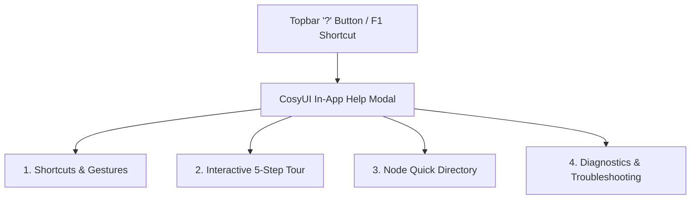
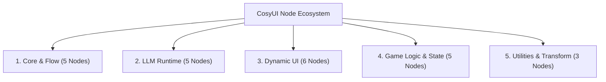
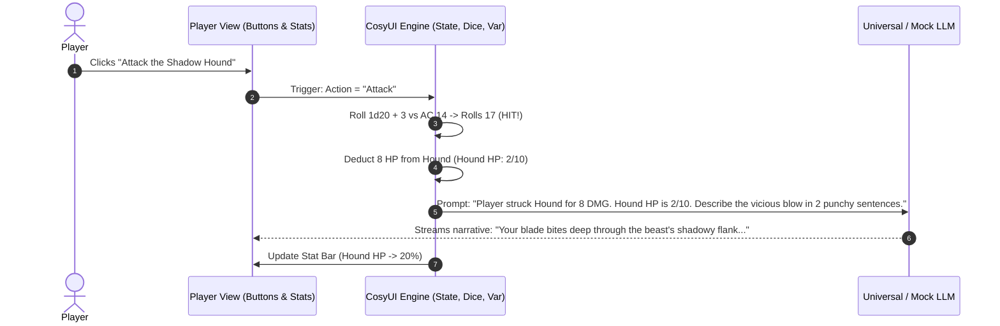
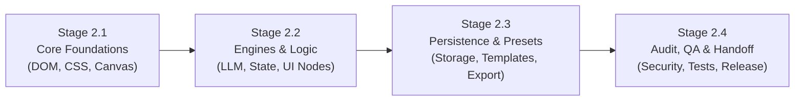

# CosyUI Documentation & Handoff Framework
**Document ID:** `Notes/10_DOCUMENTATION_FRAMEWORK.md`  
**Author:** Agent 10 (Documentation & Handoff Lead)  
**Status:** Approved Architectural Blueprint  
**Milestone:** Phase 1 (Planning & Architecture)  
**Dependencies:** `00_COLLABORATION_PROTOCOL.md`, Agents 01–09 Technical Specifications  

---

## 1. Executive Overview & Documentation Strategy

CosyUI is designed as an accessible, zero-dependency, web-native visual programming engine for building LLM-driven games and interactive interfaces. Because CosyUI bridges two distinct disciplines—**deterministic game logic** and **probabilistic LLM generation**—its documentation must serve both novice game creators and advanced AI engineers.

### 1.1 Documentation Principles
1. **Zero External Dependency / Fully Offline Capable**: Documentation must exist in-repo, in markdown, and within the in-app interactive help modal without requiring an active internet connection.
2. **Dual-Audience Clarity**: Provide approachable high-level concepts for game designers and precise I/O schemas for technical developers.
3. **Action-Oriented Recipes**: Focus on reproducible node graphs rather than abstract theory.
4. **Interactive In-App Guidance**: The documentation must be directly accessible from the canvas (`F1` or Help button), featuring an interactive 5-step guided tour.

---

## 2. Component 1: The CosyUI User Guide

The User Guide is the primary entry point for creators. It is structured into five sequential chapters:

### Chapter 1: Quickstart in 60 Seconds
- **Zero Installation**: CosyUI runs natively in any modern browser (Chrome, Firefox, Safari, Edge) as a single static web application (`index.html`). No Node.js build step, bundler, or terminal command is required to run or edit.
- **Loading the Canvas**: Open `index.html`. Users are greeted with the "Cosy Dark" canvas with a pre-loaded starter graph ("Quick Chat" or "Encounter Simulator").
- **First Run**:
  1. Click **Play / Preview** (or press `Ctrl+Enter`) to open the Player View.
  2. Type a message or click an action button.
  3. Observe real-time execution in the Offline Mock LLM mode—no API keys required.

### Chapter 2: The Two Worlds — Graph Editor vs. Player View
CosyUI splits its application state into two tightly synchronized views:
- **Graph Editor (Backend / Logic)**:
  - Infinite pannable/zoomable 2D canvas with high-performance SVG bezier cables.
  - Nodes represent data inputs, processing units, game state, UI controls, and LLM queries.
  - Real-time visual debugging: Wires glow when data pulses through them; executing nodes display active border highlights.
- **Player View (Frontend / Runtime Interface)**:
  - The live interactive game or application rendered for the end user.
  - Dynamically configured and styled by **Frontend Customizer Nodes** (`Chat Box`, `Stat Bar`, `Inventory Grid`, `Choice Buttons`, `Story Panel`).
  - Screen layouts: **Split Mode** (Canvas on left, Player View on right for live testing), **Full Canvas Mode** (focus on logic), and **Player Only Mode** (kiosk/standalone play).

### Chapter 3: Dataflow, Types & Execution Semantics
CosyUI implements a reactive dataflow architecture combining **Data Streams** with **Event Triggers**:
- **Port Typing System**:
  - `String` (Green): Plain text, prompts, LLM responses.
  - `Number` (Blue): Numerical values, dice rolls, hit points, counters, timestamps.
  - `Boolean` (Purple): `true`/`false` flags for conditional branches.
  - `Array` (Orange): Lists of inventory items, message histories, options.
  - `Object / JSON` (Yellow): Structured game states, entity definitions, API parameters.
  - `Trigger / Flow` (White / Triangle): Execution signals that initiate an action (e.g., button click, timer tick, LLM completion).
- **Execution Rules**:
  - A node executes when an incoming `Trigger` fires OR when upstream data dependencies are resolved.
  - Guard rails prevent infinite circular execution loops (maximum recursion depth limit: 100 cycles per tick).

### Chapter 4: Working with LLMs (Mock vs. Real Providers)
- **Built-in Offline Mock LLM**:
  - Requires zero internet connection and zero configuration.
  - Supports roleplay presets (Fantasy DM, Cyberpunk AI, Quirky Merchant) and customizable scripted response banks.
  - Simulates token streaming at ~30ms per token for realistic UI testing.
- **Universal LLM Provider Integration**:
  - **OpenAI**: Direct integration (`gpt-4o`, `gpt-4o-mini`, custom models).
  - **Anthropic**: Direct integration (`claude-3-5-sonnet`, `claude-3-haiku`).
  - **OpenRouter**: Access to 100+ open and closed models via a single key.
  - **Ollama**: Local, private execution on `http://localhost:11434` without data leaving the machine.
  - **Custom Endpoints**: Any OpenAI-compatible REST API.
- **Security & Privacy Guarantee**:
  - API keys are stored solely in browser `localStorage` under encrypted or isolated keys.
  - API keys are **NEVER** bundled or exported when exporting project files or standalone games.

### Chapter 5: Persistence, Sharing & Standalone Export
- **LocalStorage Quick Slots**: Auto-save on every edit + 5 named snapshot slots.
- **JSON Project Import/Export**: Clean, human-readable JSON storing all nodes, positions, connections, and custom variables.
- **Standalone Single-File HTML Export**:
  - Generates a fully self-contained `.html` file embedding the runtime, player UI, game state, and graph.
  - Can be hosted on GitHub Pages, Itch.io, or emailed to friends.
  - Player can run the game with the Mock LLM or plug in their own key locally.

---

## 3. Component 2: In-App Interactive Help Modal

The In-App Help Modal (`HelpModal.js`) is an integrated component accessible from the navigation bar or via keyboard shortcuts (`F1` or `?`).

### 3.1 Tab 1: Keyboard & Mouse Shortcuts Cheat Sheet
| Category | Shortcut | Action |
| :--- | :--- | :--- |
| **Canvas Navigation** | `Space + Drag` or `Middle Mouse Drag` | Pan canvas smoothly |
| **Canvas Navigation** | `Mouse Wheel` or `Ctrl + +/-` | Zoom canvas (0.2x to 2.5x) |
| **Canvas Navigation** | `Shift + F` | Zoom to Fit all nodes |
| **Node Actions** | `Tab` or `Space (on empty canvas)` | Open Quick-Add Node Palette |
| **Node Actions** | `Delete` or `Backspace` | Delete selected node(s) or wire |
| **Node Actions** | `Ctrl + D` | Duplicate selected node(s) |
| **Node Actions** | `Ctrl + C` / `Ctrl + V` | Copy / Paste nodes with offset |
| **Wiring** | `Drag from Socket` | Create wire with auto-socket magnetic snap |
| **Wiring** | `Alt + Click on Wire` | Insert reroute point / split wire |
| **Project & View** | `Ctrl + S` | Quick-save project to LocalStorage |
| **Project & View** | `Ctrl + Enter` | Toggle Split / Player View mode |
| **History** | `Ctrl + Z` / `Ctrl + Y` | Undo / Redo canvas operations |

### 3.2 Tab 2: Interactive 5-Step Guided Tour
The in-app tour uses an animated spotlight highlight overlay (`.cosy-tour-highlight`) that guides new users step-by-step:
1. **Step 1: The Canvas**: Explains canvas panning, zooming, and grid coordinates.
2. **Step 2: The Node Palette**: Prompts user to press `Tab` and adds a `User Input` node.
3. **Step 3: Creating Connections**: Highlights the output port of `User Input` and the input port of `Mock LLM`, instructing the user to drag a bezier wire.
4. **Step 4: The Inspector Panel**: Shows how clicking any node reveals editable parameters, system prompts, and variable bindings in the right sidebar.
5. **Step 5: Testing in Player View**: Shows how clicking "Player View" launches the interactive dialogue box where the user can test their creation.

### 3.3 Tab 3: Diagnostics & Troubleshooting Guide
- **CORS Errors with Local LLM (Ollama)**: Explanation of setting `OLLAMA_ORIGINS="*"` when connecting from browser environments.
- **API Key Missing / Rejected**: Step-by-step instructions for entering valid API keys in the settings modal.
- **Wire Disconnections & Type Mismatches**: Visual indicators when trying to connect incompatible sockets (e.g., connecting an `Array` to a `Number` input without a converter node).
- **Infinite Loop Detection**: How CosyUI automatically stops execution when an uncontrolled cyclic wire triggers >100 evaluations in 1 second, with a 1-click "Highlight Offending Loop" button.

---

## 4. Component 3: Node Reference Manual

Every node in CosyUI adheres to a standardized specification format. Below is the taxonomy and reference schema for all 24 initial nodes across 5 functional categories:

### 4.1 Node Specification Standard
Each node definition in the reference manual must provide:
1. **Node Identity**: Name, Internal Type Key, Category, Icon.
2. **Purpose & Use Cases**: 1-2 sentence description.
3. **Input Ports**: Port Name, Type, Description, Required/Optional, Default.
4. **Output Ports**: Port Name, Type, Description.
5. **Inspector Config Properties**: Settings editable in the sidebar.
6. **Execution Behavior**: Deterministic logic executed when triggered.

### 4.2 Comprehensive Node Directory

#### Category 1: Core & Flow Nodes
| Type Key | Node Name | Inputs | Outputs | Description |
| :--- | :--- | :--- | :--- | :--- |
| `core.start` | **Game Start / Init** | None | `Trigger (Out)` | Fires once when the project or game loads. Used to initialize variables, default stats, and starting scenes. |
| `core.trigger` | **Event Trigger** | `Event Name (Str)` | `Trigger (Out)`, `Payload (Obj)` | Listens for custom internal game events or hotkeys to branch execution. |
| `core.branch` | **Conditional Branch** | `Trigger (In)`, `Condition (Bool)` | `True (Trigger)`, `False (Trigger)` | Splits execution flow based on a boolean condition check. |
| `core.delay` | **Timer / Delay** | `Trigger (In)`, `Milliseconds (Num)` | `Trigger (Out)` | Pauses execution for a specified duration before pulsing the output trigger. |
| `core.router` | **Multi-Way Switch** | `Trigger (In)`, `Value (Str/Num)` | `Case 1..N (Trigger)`, `Default (Trigger)` | Evaluates a value against configured match cases and fires the matching branch. |

#### Category 2: LLM Runtime Nodes
| Type Key | Node Name | Inputs | Outputs | Description |
| :--- | :--- | :--- | :--- | :--- |
| `llm.request` | **Universal LLM** | `Trigger (In)`, `Prompt (Str)`, `System (Str)`, `History (Arr)` | `Trigger (Out)`, `Response (Str)`, `Stream (Str)`, `Error (Str)` | Dispatches requests to OpenAI, Anthropic, OpenRouter, Ollama, or Custom API. Emits streaming tokens and full response. |
| `llm.mock` | **Offline Mock LLM** | `Trigger (In)`, `Prompt (Str)`, `Preset (Str)` | `Trigger (Out)`, `Response (Str)`, `Stream (Str)` | Fully offline generator with simulated token streaming, roleplay presets, and scripted fallback tables. |
| `llm.template` | **Prompt Template** | `Var 1..N (Any)`, `Template (Str)` | `Result (Str)` | Mustache-style interpolation (`{{player_name}} has {{hp}} HP`) to assemble dynamic prompts safely. |
| `llm.memory` | **Conversation Buffer** | `Add Message (Str)`, `Role (Str)`, `Clear (Trigger)` | `History (Arr)`, `Formatted (Str)` | Manages a sliding window of conversation turns (user/assistant) with configurable max turn memory. |
| `llm.json_extract` | **JSON Extractor** | `Text (Str)`, `Schema (Obj)` | `Data (Obj)`, `Success (Bool)` | Robustly extracts and parses JSON blobs embedded in LLM output strings, handling markdown code fences. |

#### Category 3: Dynamic UI / Frontend Customizer Nodes
| Type Key | Node Name | Inputs | Outputs | Description |
| :--- | :--- | :--- | :--- | :--- |
| `ui.dialogue` | **Dialogue / Chat Box** | `Message (Str)`, `Sender (Str)`, `Avatar (Str)` | `Submitted (Trigger)`, `Input Text (Str)` | Renders an animated chat or dialogue box in the Player View with player input field. |
| `ui.stat_bar` | **Stat Bar Widget** | `Value (Num)`, `Max (Num)`, `Label (Str)`, `Color (Str)` | None | Displays a progress bar (e.g. Health, Mana, Sanity) in the Player View HUD. |
| `ui.inventory` | **Inventory Grid** | `Items (Arr)`, `Add Item (Str)`, `Remove Item (Str)` | `Selected Item (Str)`, `On Click (Trigger)` | Renders visual item slots in the Player View. Supports clicking an item to inspect or use it. |
| `ui.choices` | **Choice Buttons** | `Options (Arr)`, `Disabled (Bool)` | `Selected (Str)`, `Index (Num)`, `On Click (Trigger)` | Renders dynamic action buttons (e.g. "Attack", "Flee", "Bribe") for branching narrative decisions. |
| `ui.story_panel` | **Story Narrative Panel**| `Text (Str)`, `Title (Str)`, `Image URL (Str)` | None | Renders formatted rich text narrative descriptions, scene headers, and illustrative artwork. |
| `ui.theme` | **Theme Customizer** | `Primary (Str)`, `Background (Str)`, `Font (Str)` | None | Customizes styling, fonts, borders, and colors of the Player View interface in real time. |

#### Category 4: Game Logic & State Nodes
| Type Key | Node Name | Inputs | Outputs | Description |
| :--- | :--- | :--- | :--- | :--- |
| `game.state` | **State Machine** | `Trigger (In)`, `Transition To (Str)` | `Current State (Str)`, `On Enter (Trigger)` | Manages discrete game states (e.g., `Exploration`, `Combat`, `Dialogue`, `Game Over`). |
| `game.variable` | **Variable Store** | `Set Value (Any)`, `Key (Str)`, `Op (Set/Add/Sub)`| `Current Value (Any)`, `On Change (Trigger)` | Stores persistent game variables (gold, quest flags, relationship counters) in memory. |
| `game.dice` | **Dice Roller** | `Trigger (In)`, `Notation (Str, e.g. 2d6+3)` | `Result (Num)`, `Rolls (Arr)`, `Critical (Bool)`| Deterministic PRNG dice roller supporting standard TTRPG notation (`1d20`, `3d6`, `d100`). |
| `game.condition` | **Logic Condition** | `A (Any)`, `B (Any)`, `Operator (==, !=, >, <, >=, <=, in)`| `Result (Bool)` | Evaluates standard relational expressions between two values. |
| `game.turn` | **Turn Counter** | `Next Turn (Trigger)`, `Reset (Trigger)` | `Turn (Num)`, `Round (Num)` | Tracks turn progression and round counts for tabletop and encounter simulations. |

#### Category 5: Utilities & Transform Nodes
| Type Key | Node Name | Inputs | Outputs | Description |
| :--- | :--- | :--- | :--- | :--- |
| `util.math` | **Math Evaluator** | `A (Num)`, `B (Num)`, `Op (+,-,*,/,%)` | `Result (Num)` | Performs basic mathematical operations on inputs. |
| `util.string` | **String Concatenator**| `A (Str)`, `B (Str)`, `Separator (Str)` | `Result (Str)` | Merges text strings together. |
| `util.inspect` | **Debug Inspector** | `Data (Any)` | None | In-graph visual inspector showing the exact real-time value and type of any wire for easy debugging. |

---

## 5. Component 4: Game Design with LLMs Tutorial

### 5.1 The Core Game Design Philosophy
Traditional game development relies on **deterministic state** (health points, inventory arrays, spatial coordinates). Pure LLM-based games typically fail because LLMs are **probabilistic text predictors**:
- An LLM will happily grant a player a sword that was never looted.
- An LLM will forget how much gold the player holds after 10 conversation turns.
- An LLM will allow a player to talk their way past a DC 25 lock without rolling dice.

**The CosyUI Paradigm**:
> **"Deterministic Game Mechanics Rule the World; The LLM Gives the World Its Voice."**

### 5.2 Step-by-Step Tutorial: "The Crypt of the Silver Lich"
This tutorial guides the user through building an encounter from scratch in 10 minutes:

#### Step 1: Initialize Player State
- Add `Game Start` node.
- Connect to three `Variable Store` nodes:
  - `player_hp` = `20`
  - `silver_keys` = `0`
  - `lich_hp` = `30`
- Connect to `Stat Bar` node:
  - Value: bind to `player_hp`
  - Max: `20`
  - Label: "Adventurer Vitality"
  - Color: `#10b981` (Emerald Green)

#### Step 2: Render Initial Narrative
- Add `Story Panel` node. Set Title: *"The Obsidian Door"*.
- Set Text: *"You stand before a crypt door sealed with frost and ancient runes. Cold mist clings to your boots."*
- Add `Choice Buttons` node with options:
  - `[1] Inspect the Runes (Arcana Check)`
  - `[2] Force the Door (Athletics Check)`
  - `[3] Speak a Word of Power`

#### Step 3: Handle the Choice with Dice Roller
- Wire `Choice Buttons: On Click` into `Multi-Way Switch`.
- For Option 1 (Arcana):
  - Wire to `Dice Roller` (`1d20 + 4`).
  - Wire result into `Logic Condition` (`>= 15`).
  - If `True`:
    - Increment `silver_keys` by 1.
    - Feed prompt into `Universal / Mock LLM`: *"You decipher the glowing sigils. A secret compartment opens revealing a Silver Key. Describe this discovery with suspense."*
  - If `False`:
    - Decrement `player_hp` by 3 (Trap triggers!).
    - Feed prompt into `Universal / Mock LLM`: *"The runes flare with blue lightning, shocking you for 3 damage. Describe the painful jolt."*

#### Step 4: Stream the Result to the Story Panel
- Wire `LLM: Stream` directly into `Story Panel: Text`.
- The player witnesses the LLM stream the dynamic outcome while the underlying game state (HP, inventory keys) remains 100% accurate and mathematically enforced!

---

## 6. Structure & Requirements for `HANDOFF_PHASE_1_PLANNING.md`

Agent 10 is tasked with establishing the official milestone handoff standard for Phase 1. The milestone document located at `/home/antigravity/someonenameguy/CosyUI/Handoffs/HANDOFF_PHASE_1_PLANNING.md` must fulfill the following mandatory structure and verification requirements:

### 6.1 Required Document Sections
1. **Milestone Metadata**:
   - Milestone Title: `Phase 1 Planning & Architecture Sign-Off`
   - Completion Date & Status.
   - Lead Author and Contributing Agents (Agents 01 through 10).
2. **Executive Summary**:
   - High-level project definition and core problem statement.
   - Architectural pillars: Zero dependencies, HTML5/ES6 web-native, dual-canvas/player paradigm, universal LLM + offline mock runtime.
3. **Agent Architecture & Deliverables Matrix**:
   - Detailed status of all 10 specialized agent domains:
     - *Agent 01*: System Architecture, Port Typings, Execution Pipeline.
     - *Agent 02*: Canvas Engine, Bezier SVG Wires, Drag/Drop, Zoom/Pan.
     - *Agent 03*: LLM Runtime, Provider Integrations, Streaming Protocol.
     - *Agent 04*: Frontend Customizer, Dynamic UI Widgets, Player View Container.
     - *Agent 05*: Game Engine, State Machine, Variable Store, Dice Engine.
     - *Agent 06*: Storage System, LocalStorage Slots, JSON & Standalone Bundler.
     - *Agent 07*: Cosy UI/UX Design System, CSS Theme Tokens, Responsive Layouts.
     - *Agent 08*: Code Auditor, Loop Safety Guards, Security & Error Boundaries.
     - *Agent 09*: Quality Assurance, Automated Test Suite, Test Runner Spec.
     - *Agent 10*: Documentation Framework, User Guide, Node Directory, Milestone Lead.
4. **Master Graph Data Schema Contract**:
   - Formal JSON schema specification defining `CosyGraph`, `CosyNode`, `CosyPort`, and `CosyConnection`.
5. **Phase 1 Verification & Acceptance Criteria**:
   - Explicit checklist confirming zero architectural ambiguities prior to code integration.
6. **Phase 2 Implementation Roadmap**:
   - Clear sequential rollout plan for building the codebase in Phase 2.

---

## 7. Outline of Steps for Phase 2: Implementation & Code Integration

Phase 2 transitions the project from architectural design to code implementation. All 10 agents operate according to a synchronized 4-stage pipeline:

### Stage 2.1: Core Foundations & Canvas Shell
- **Step 1: HTML/CSS Base Setup**:
  - Create `/home/antigravity/someonenameguy/CosyUI/index.html` with zero external dependencies.
  - Implement `/home/antigravity/someonenameguy/CosyUI/css/cosy-theme.css` incorporating the "Cosy Dark" design tokens (Agent 07).
  - Setup core layout: Topbar, Canvas Container, Inspector Sidebar, Player View Drawer.
- **Step 2: Canvas & Graph Interaction Engine (Agent 02)**:
  - Implement `js/engine/Canvas.js`: Infinite grid, smooth pan & zoom matrix transformations.
  - Implement `js/engine/NodeRenderer.js`: DOM node elements, header icons, socket rendering.
  - Implement `js/engine/WireRenderer.js`: High-performance SVG cubic bezier curves, magnetic socket snapping, color-coded types.
  - Implement `js/engine/Selection.js`: Multi-node box selection, drag movement, deletion, and duplication.

### Stage 2.2: Execution Engine, LLM Runtime & Dynamic UI
- **Step 3: Graph Execution Pipeline (Agent 01 & 08)**:
  - Implement `js/engine/GraphRuntime.js`: Reactive dependency evaluation, topological sorting, event dispatching.
  - Integrate infinite loop protection and call stack safeguards (Agent 08).
- **Step 4: LLM Runtime & Provider Connectors (Agent 03)**:
  - Implement `js/llm/UniversalLLMClient.js`: Fetch-based streaming client for OpenAI, Anthropic, OpenRouter, and Ollama.
  - Implement `js/llm/MockLLM.js`: Offline simulator with customizable token streaming and roleplay presets.
- **Step 5: Dynamic Player UI & Customizer Widgets (Agent 04)**:
  - Implement `js/ui/PlayerView.js`: Split-screen and full-screen player runtime container.
  - Implement widget renderers: `DialogueBox`, `StatBar`, `InventoryGrid`, `ChoiceButtons`, `StoryPanel`.
- **Step 6: Game Logic & State Engine (Agent 05)**:
  - Implement `js/game/StateMachine.js`, `VariableStore.js`, `DiceRoller.js`, `ConditionGate.js`.

### Stage 2.3: Storage, Presets & Interactive Help
- **Step 7: Storage & Standalone Bundler (Agent 06)**:
  - Implement `js/storage/ProjectStorage.js`: LocalStorage slots and JSON export/import.
  - Implement `js/storage/StandaloneExporter.js`: Inlines runtime JS, CSS, and current graph into a single self-executable `.html` file.
  - Create 4 pre-built project templates:
    1. *Quick Chatbot* (Minimalist conversational assistant).
    2. *TTRPG Dungeon Encounter* (Interactive dungeon with HP, dice checks, and inventory).
    3. *Cyberpunk Detective* (Branching murder mystery investigation with clue inventory).
    4. *Philosophical Debate* (Dual LLM agents conversing with human moderation).
- **Step 8: In-App Help Modal & Interactive Tour (Agent 10 & 07)**:
  - Implement `js/ui/HelpModal.js` featuring shortcuts cheat sheet, node search, and the 5-step guided tour.

### Stage 2.4: Code Audit, Test Automation & Production Launch
- **Step 9: Security & Resilience Audit (Agent 08)**:
  - Comprehensive edge-case audit: Circular wiring, null inputs, malformed JSON, API network disconnects.
  - Ensure zero external network leaks of API keys.
- **Step 10: Automated Test Suite & Verification (Agent 09)**:
  - Implement `tests/run_tests.js`: Vanilla JavaScript test runner verifying all 24 nodes, serialization round-trips, and execution flows.
- **Step 11: Final Production Release & Documentation Sign-Off (Agent 10)**:
  - Assemble `README.md`, verified user documentation, and final milestone handoff documentation.

---

## 8. Summary of Agent 10 Deliverables

Agent 10 has established the complete documentation, education, and handoff architecture for CosyUI:
1. `Notes/10_DOCUMENTATION_FRAMEWORK.md`: The definitive architectural blueprint for user documentation, in-app help, node specifications, and game design tutorials.
2. `Handoffs/HANDOFF_PHASE_1_PLANNING.md`: The authoritative milestone completion document validating Phase 1 planning across all 10 agents and setting Phase 2 in motion.
